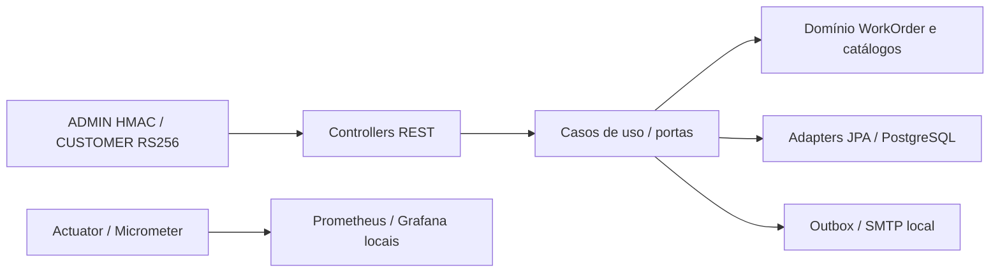

# Oficina Mecânica — Tech Challenge FIAP, Fase 3

**Grupo 97** · **Pedro Paulo dos Santos Silva** · Discord **pedropaulo6447**.
API de gestão de clientes, veículos, catálogo, estoque e ordens de serviço, com
monólito hexagonal e regras de negócio no agregado WorkOrder.

**[Documentação final da Fase 3](docs/fase3/README.md)** ·
[Arquitetura implantada](docs/fase3/deployment-architecture.md) ·
[Sequências](docs/fase3/sequences.md) · [MER V1–V11](docs/fase3/data-model.md) ·
[RFCs/ADRs](docs/fase3/decisions.md) · [Matriz de evidências](docs/fase3/evidence-matrix.md).

## Estado auditado em 2026-11-03

Staging AWS observado: EC2/K3s com API 3/3 Ready e HPA 1–3, imagem por digest,
RDS privado e Single-AZ. Service ClusterIP, sem Ingress. Lambda de autenticação
ativa porém bloqueada por concorrência zero; HTTP API endpoint desabilitado.
Prometheus/Grafana estão versionados para uso local e ausentes do cluster consultado;
tracing não comprovado. CI main verde; CD AWS não implantado, OIDC em PRs abertas
com auditoria bloqueada por SCP. Produção não demonstrada. Veja a
[coleta sanitizada](docs/fase3/operational-evidence.md) e os
[trade-offs](docs/fase3/trade-offs.md); nenhuma consulta documental alterou o ambiente.

## Stack e organização

Java 21, Spring Boot 3.5.14, Spring Web/Security/Data JPA/Mail, Flyway,
PostgreSQL 16, JWT HMAC administrativo e RS256 CUSTOMER, Actuator/Micrometer,
Springdoc OpenAPI, Maven, JUnit 5, JaCoCo e Testcontainers. Docker Compose e
Kind/Terraform local oferecem demonstração reproduzível.

- [Domínio](src/main/java/br/com/fiap/techchallenge/oficina/domain): invariantes e transições.
- [Aplicação](src/main/java/br/com/fiap/techchallenge/oficina/application): portas e casos de uso.
- [Adapters](src/main/java/br/com/fiap/techchallenge/oficina/adapters): REST, persistência, segurança e SMTP.
- [Migrations](src/main/resources/db/migration): schema e views, V1–V11.
- [Manifests](k8s): local e staging; [observabilidade local](observability).



## Execução local

Requisitos: Java 21/Maven para desenvolvimento, Docker com Compose para dependências
e suíte completa. Os arquivos locais incluem configurações demonstrativas;
**não usá-los como configuração cloud**. Dados devem ser sintéticos, nunca CPFs reais.

```bash
docker compose up -d --build
docker compose ps
# Encerra containers; preserva o volume do banco:
docker compose down
```

Para executar Java fora do container, iniciar somente as dependências e ativar
explicitamente o perfil local:

```bash
docker compose up -d postgres mailpit
mvn spring-boot:run -Dspring-boot.run.profiles=local
```

Portas locais: API 8080, Mailpit 8025 (UI)/1025 (SMTP), Prometheus 9090, Grafana 3000.
O Compose publica em loopback. Credenciais demonstrativas são definidas nos arquivos
locais e omitidas deste documento; nunca copiar para staging. Configurações:
[application-local.yml](src/main/resources/application-local.yml),
[docker-compose.yml](docker-compose.yml). CUSTOMER requer emissor/chaves confiáveis;
sem configuração válida, login CUSTOMER falha fechado.

Kind/Terraform local: seguir [runbook existente](infra/terraform/local/README.md).
Esse ambiente não é o K3s AWS. A outbox local entrega ao Mailpit; SMTP/outbox automática
estão desabilitados no perfil staging até configuração operacional própria.

## Swagger e contratos

Com a API local em execução: [Swagger UI](http://localhost:8080/swagger-ui/index.html)
e [OpenAPI JSON](http://localhost:8080/v3/api-docs). Links locais, não serviços públicos.
Não há URL pública de Swagger staging comprovada. Acesso autorizado via SSM/túnel
está descrito nos runbooks, mantendo ClusterIP e SGs fechados.

| Operação | Rota e autorização |
|---|---|
| Login administrativo | `POST /api/v1/auth/login`; credencial administrativa configurada |
| Clientes, veículos, serviços e peças | `/api/v1/admin/customers`, `/vehicles`, `/services`, `/parts`; ADMIN |
| Criar/listar/detalhar OS | `POST/GET /api/v1/admin/work-orders`, `GET /{id}`; ADMIN |
| Diagnóstico e itens | `POST /api/v1/admin/work-orders/{id}/diagnosis/start`, `/diagnosis/notes`, `/items`; ADMIN |
| Orçamento/execução/entrega | `POST /api/v1/admin/work-orders/{id}/budget/notify`, `/approve`, `/finish`, `/deliver`; ADMIN |
| Decisão e status por código | `POST /api/v1/public/work-orders/{code}/status`, `/budget/approve`, `/budget/reject`; ADMIN ou CUSTOMER proprietário, documento no body |
| Consulta mínima por UUID | `GET /api/v1/customer/work-orders/{id}`; CUSTOMER proprietário via JWKS |
| Outbox manual | `POST /api/v1/admin/notifications/outbox/process`; ADMIN |
| Tempo médio de execução | `GET /api/v1/admin/metrics/average-execution-time`; ADMIN; filtros from/to |

O prefixo `public` não dispensa JWT. A cadeia por código usa PEM, a por UUID usa
JWKS; configure ambas quando um token precisar operar nas duas famílias. O fluxo
[Lambda CPF → RS256](docs/fase3/sequences.md) usa somente demonstração sintética.
Tokens nunca devem ser colocados em exemplos versionados, URLs ou logs.

Criação resolve cliente/veículo, inclui itens e calcula orçamento; não baixa estoque.
Aprovação baixa estoque sob locks; recusa inicial gera BUDGET_REJECTED; finalização
e entrega são operações administrativas. Transições são persistidas no histórico.
Lista padrão de OS exclui BUDGET_REJECTED/FINALIZED/DELIVERED e ordena IN_EXECUTION,
WAITING_APPROVAL, IN_DIAGNOSIS, RECEIVED; filtro explícito permite consultar os demais.

## Testes e CI/CD

```bash
mvn -B clean verify
python3 scripts/staging/test-render.py
git diff --check
```

A suíte completa exige Docker para PostgreSQL Testcontainers; testes de domínio e
aplicação também usam mocks/H2 conforme perfil. Relatório JaCoCo em
`target/site/jacoco/index.html`. SMTP é mockado em testes; Mailpit não é requisito.
Não confundir seleção parcial com suíte completa ou cobertura aprovada.

[Workflow CI](.github/workflows/ci.yml): Maven/JaCoCo, Docker build, Terraform local,
renderer e kubeconform; [Kind smoke manual](.github/workflows/kind-smoke.yml).
[Estado dos quatro CIs e OIDC/CD](docs/fase3/cicd-strategy.md).

## Deploy e segurança

[Preparação staging](docs/staging/deployment.md),
[consolidação](docs/staging/consolidation.md) e
[release manual](docs/staging/release-local.md) contêm procedimentos operacionais.
Revisar digest real, Secrets/ConfigMaps externos, CA RDS, JWKS/PEM e credenciais por
finalidade. Flyway roda em Job separado, nunca com role runtime. O renderer exige
digest; não aplicar placeholders nem overlay staging diretamente. Rollback por
imagem não desfaz migrations. Esta documentação não executa release.

ADMIN/CUSTOMER usam domínios de confiança separados; ownership é verificado no
backend. CPF sozinho não comprova identidade. Prometheus é anônimo na aplicação e
precisa proteção de rede/acesso antes de qualquer exposição externa. Não incluir
CPF, token, senha, chave privada, kubeconfig ou state em PRs. A privacidade/limites
observados constam na [matriz](docs/fase3/evidence-matrix.md).

## Repositórios e acervo

[Auth Lambda](https://github.com/ppdssdev/tech-challenge-oficina-auth-lambda) ·
[Infra K3s](https://github.com/ppdssdev/tech-challenge-oficina-infra-k3s) ·
[Infra RDS](https://github.com/ppdssdev/tech-challenge-oficina-infra-rds).
Ownership e contratos: [repositórios](docs/fase3/repositories.md).

Vídeo e PDFs/PNGs antigos pertencem ao acervo das fases anteriores; não comprovam
estado atual. A entrega Fase 3 usa os diagramas Mermaid e a identificação Grupo 97
no índice acima. Os relatórios históricos permanecem identificados por data/contexto.
