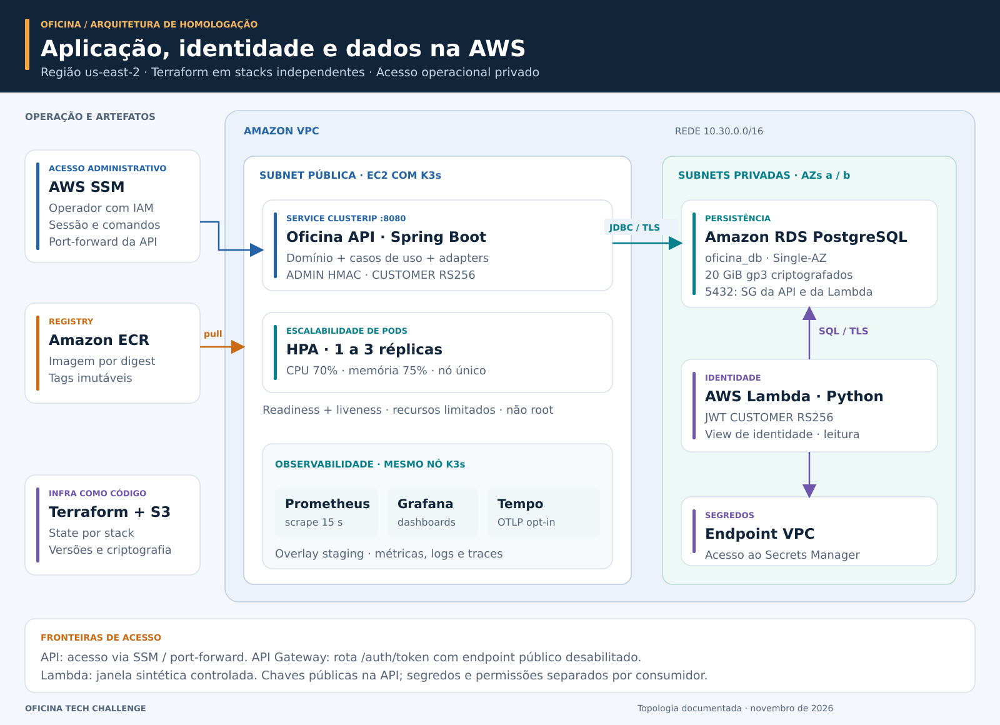
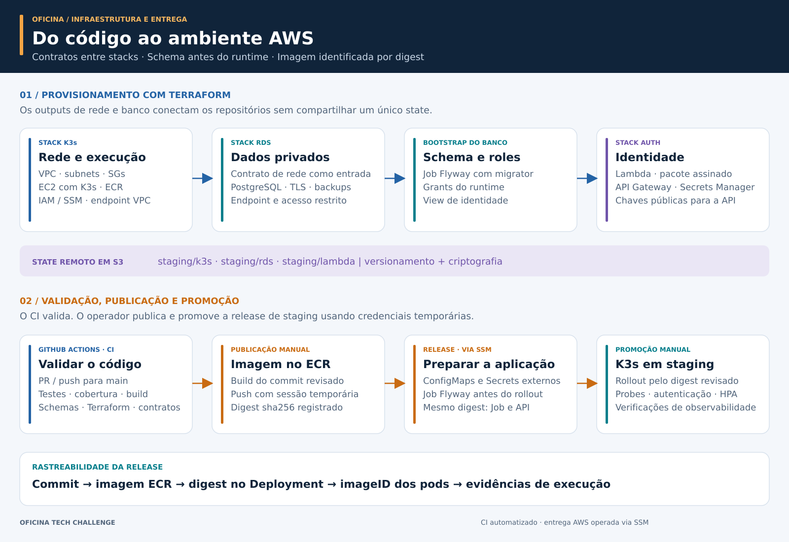

[](docs/images/oficina-arquitetura-aws.svg)

# Oficina · Tech Challenge

**Gestão de oficinas mecânicas, da abertura da ordem de serviço à entrega do veículo.**

API REST desenvolvida em **Java 21 e Spring Boot**, com arquitetura hexagonal, regras de negócio orientadas ao domínio e infraestrutura provisionada na **AWS com Terraform**. A solução reúne clientes, veículos, orçamento, estoque e acompanhamento de serviços em uma operação rastreável, com autenticação JWT e observabilidade.

O ambiente de homologação combina **Kubernetes com K3s em EC2**, **Amazon RDS PostgreSQL**, **Amazon ECR** e autenticação de clientes com **AWS Lambda**. A administração acontece pelo **AWS Systems Manager (SSM)**, e a entrega utiliza imagens identificadas por digest.

[Arquitetura AWS](#arquitetura-na-aws) · [Provisionamento](#provisionamento-e-entrega) · [Execução local](#execução-local) · [Demonstração da API](#demonstração-da-api) · [Documentação](#documentação)

## O que a solução entrega

| Capacidade | Aplicação no dia a dia da oficina |
| --- | --- |
| Clientes e veículos | Cadastro, validação de CPF/CNPJ e placa, vínculo de propriedade e ativação/inativação de clientes. |
| Ordens de serviço | Abertura, diagnóstico, orçamento, aprovação ou recusa, execução, finalização e entrega. |
| Serviços e peças | Catálogo de serviços, composição de orçamento e valores preservados nos itens da OS. |
| Estoque consistente | Baixa na aprovação, validação de disponibilidade e proteção contra atualizações concorrentes. |
| Acompanhamento | Consulta autenticada pelo proprietário e histórico persistido das mudanças de status. |
| Notificações | Outbox transacional, processamento concorrente com retries e demonstração de e-mail com Mailpit no ambiente local. |
| Operação observável | Métricas técnicas e de negócio, dashboards, logs estruturados e integração de tracing. |

## Arquitetura na AWS

A capa apresenta a topologia de staging: EC2, cluster K3s, réplicas da API, RDS privado, autenticação Lambda e serviços de suporte. [Abra o diagrama em tamanho completo](docs/images/oficina-arquitetura-aws.svg) para explorar as conexões e os limites da rede.

A infraestrutura está organizada em uma VPC na região **`us-east-2` (Ohio)**. O nó EC2 executa K3s em uma subnet pública, enquanto o RDS e as interfaces de rede da Lambda utilizam subnets privadas. A API é exposta dentro do cluster por um Service **ClusterIP**, com acesso operacional por SSM e encaminhamento de portas.

| Componente | Papel na arquitetura |
| --- | --- |
| **Amazon VPC e Security Groups** | Segmentação da rede e acesso ao PostgreSQL na porta 5432 restrito aos grupos da aplicação e da autenticação. |
| **Amazon EC2 + K3s** | Execução dos containers da API, probes de saúde, limites de recursos e HPA de **1 a 3 réplicas**, com alvos de CPU de 70% e memória de 75%. |
| **Amazon RDS PostgreSQL** | Banco `oficina_db` privado, armazenamento gp3 criptografado de 20 GiB, Single-AZ e retenção de backup configurada em um dia. Conexões com TLS e `verify-full`. |
| **Amazon ECR** | Armazenamento da imagem da API, tags imutáveis e promoção pelo identificador `sha256` da imagem. |
| **AWS Lambda + API Gateway** | Emissão de JWT CUSTOMER RS256 e contrato `POST /auth/token`. A Lambda consulta uma view de identidade com usuário de banco restrito. |
| **AWS Secrets Manager + IAM** | Segredos e permissões separados por consumidor; acesso da Lambda ao Secrets Manager por endpoint privado da VPC. |
| **AWS Systems Manager** | Administração do nó, comandos de operação e acesso às ferramentas internas. |
| **Amazon S3** | State remoto do Terraform separado por stack, com versionamento e criptografia. |
| **Prometheus, Grafana e Tempo** | Stack de observabilidade definida nos manifests de staging, com acesso privado. CloudWatch recebe os logs configurados para Lambda e API Gateway. |

O staging utiliza **um nó EC2 e RDS Single-AZ**. O HPA escala os pods dentro da capacidade desse nó. A autenticação Lambda é usada em janelas controladas de demonstração com identidades sintéticas; fora dessas janelas, sua concorrência é zero. O endpoint público padrão do API Gateway permanece desabilitado.

O [guia de consolidação de staging](docs/staging/consolidation.md) reúne a configuração de homologação, o HPA e a seleção de imagens por digest. O [runbook de promoção](docs/staging/promotion-manual.md) descreve como verificar a imagem publicada no ECR e promover a release no K3s via SSM.

## Provisionamento e entrega



### Quatro repositórios, responsabilidades definidas

| Repositório | Responsabilidade |
| --- | --- |
| [**Aplicação · este repositório**](https://github.com/ppdssdev/tech-challenge-oficina) | API Java, domínio, migrations Flyway, imagem Docker, manifests Kubernetes e observabilidade. |
| [**Infraestrutura K3s**](https://github.com/ppdssdev/tech-challenge-oficina-infra-k3s) | Terraform da VPC, subnets, Security Groups, EC2/K3s, ECR, IAM/SSM e endpoint do Secrets Manager. |
| [**Infraestrutura RDS**](https://github.com/ppdssdev/tech-challenge-oficina-infra-rds) | Terraform do PostgreSQL gerenciado, subnet group, acesso privado, armazenamento e backups. |
| [**Autenticação Lambda**](https://github.com/ppdssdev/tech-challenge-oficina-auth-lambda) | Emissor Python de JWT RS256, integração com identidade no RDS e Terraform da Lambda/API Gateway. |

Cada stack tem seu próprio state. Os repositórios se integram por contratos de outputs, como VPC, subnets privadas, Security Groups e endpoint do banco. O Terraform em [`infra/terraform/local`](infra/terraform/local/README.md), dentro deste repositório, atende ao ambiente **Kind local**; os recursos AWS são gerenciados nos repositórios acima.

### Ordem de provisionamento

1. **Rede e execução:** provisionar a stack K3s com VPC, subnets, grupos de segurança, nó EC2, ECR e permissões de operação. Disponibilizar o contrato de rede para as outras stacks.
2. **Persistência:** provisionar o RDS privado a partir desse contrato e obter o hostname do banco e as referências de configuração.
3. **Schema e permissões:** criar as roles PostgreSQL, executar as migrations em um **Job Flyway separado** e aplicar os grants de runtime e leitura de identidade.
4. **Autenticação:** configurar os segredos, implantar o pacote assinado da Lambda e alinhar emissor, audiência e chaves públicas com a API.
5. **Aplicação:** fornecer ConfigMaps e Secrets de staging, publicar a imagem no ECR e promover o digest no K3s via SSM. Aguardar o Job de migration antes do rollout quando a release incluir migrations.
6. **Operação:** verificar readiness/liveness, acesso ao banco, autenticação, HPA e os componentes de observabilidade utilizados na demonstração.

O runtime usa `oficina_api` para operações de negócio; migrations usam `oficina_migrator`; a Lambda usa `oficina_lambda` com leitura da view de identidade. Em staging, o Flyway fica desabilitado na API e o Hibernate valida o schema. Assim, escalar a aplicação não executa migrations.

Os parâmetros, contratos e procedimentos de Terraform estão nos READMEs das stacks. Para a aplicação, consulte os [contratos de configuração e bootstrap](docs/staging/deployment.md), a [renderização por digest](docs/staging/consolidation.md) e o [procedimento de promoção e rollback](docs/staging/promotion-manual.md). Os documentos de preparação preservam o contexto da etapa em que foram escritos; os manifests versionados e os procedimentos de consolidação orientam a configuração de staging.

### Integração contínua e publicação

O **GitHub Actions** executa validações em pushes e pull requests para `main`. Na aplicação, o workflow [CI](.github/workflows/ci.yml) verifica:

- testes Maven, integração com PostgreSQL via Testcontainers e cobertura JaCoCo;
- build e inspeção da imagem Docker;
- formatação e validação do Terraform local;
- renderização dos manifests local/staging, validação de schemas Kubernetes e configuração de staging.

Há também workflows de [validação de observabilidade](.github/workflows/observability-validate.yml) e [smoke test com Kind](.github/workflows/kind-smoke.yml). Os demais repositórios possuem pipelines próprios para Python, empacotamento e infraestrutura.

A **publicação no ECR e a promoção em staging são manuais**, com credenciais temporárias e acesso SSM. O operador utiliza [`release-local.sh`](scripts/staging/release-local.sh) para publicar e o runbook de promoção para aplicar o digest revisado. A automação de CI valida o código e os artefatos; a execução da entrega AWS segue esse procedimento operacional.

## Arquitetura da aplicação

A API é um **monólito modular com arquitetura hexagonal**. As regras de negócio ficam no domínio, os casos de uso coordenam as operações e as portas isolam os detalhes de persistência, autenticação e notificação.

```text
src/main/java/br/com/fiap/techchallenge/oficina
├── domain          Entidades, objetos de valor, estados e regras de negócio
├── application
│   ├── port/in     Contratos dos casos de uso
│   ├── port/out    Contratos de persistência e integrações
│   └── usecase     Orquestração e fronteiras transacionais
├── adapters
│   ├── in/web      Controllers REST, DTOs e tratamento de erros
│   └── out         Persistência JPA, segurança e notificações
└── configuration   Composição das dependências e configuração Spring
```

O agregado **`WorkOrder`** controla o ciclo de vida da OS, a composição do orçamento e as transições de estado. Os itens guardam os preços usados na contratação, e o histórico de status é persistido na mesma transação da ordem. CPF/CNPJ e placa são tratados por objetos de valor e validações do domínio.

O PostgreSQL sustenta integridade referencial, valores monetários precisos e transações entre ordem de serviço, estoque e histórico. Na aprovação, locks protegem a OS e as peças envolvidas; a entidade persistente de peça também usa versionamento otimista. A aprovação por código aceita `Idempotency-Key`, evitando repetir a baixa de estoque em uma tentativa reenviada com a mesma chave e os mesmos dados.

A outbox persiste a intenção de notificação e distribui o processamento entre workers por claim transacional com `FOR UPDATE SKIP LOCKED`. As mensagens passam por `PENDING`, `PROCESSING`, `SENT` ou `FAILED`, com limite de tentativas e recuperação de claims expirados. No ambiente local, o adapter SMTP entrega ao Mailpit. Em staging, o processamento automático está desabilitado no perfil até a configuração do SMTP.

### Segurança e identidade

| Acesso | Autenticação e autorização |
| --- | --- |
| **Administrativo** | Login com credenciais persistidas, JWT HMAC e papel `ADMIN` nas rotas `/api/v1/admin/**`. |
| **Cliente** | JWT RS256 emitido pela Lambda, validação de assinatura, emissor, audiência e validade; consulta limitada ao proprietário da OS. |
| **Consulta por UUID** | `/api/v1/customer/work-orders/{id}` utiliza o Resource Server com JWKS via HTTPS. |
| **Consulta e decisão por código** | `/api/v1/public/work-orders/{code}/...` exige autenticação ADMIN ou CUSTOMER; para CUSTOMER, valida a propriedade. O documento também é enviado no corpo. |

O prefixo histórico `/public` **exige autenticação**. As chaves e cadeias de validação ADMIN e CUSTOMER são separadas. Os detalhes estão no [ADR de domínios de confiança](docs/adr/0005-admin-customer-trust-domains.md) e no [contrato de integração RS256](docs/fase3/customer-rs256-integration.md).

## Stack

| Área | Tecnologias |
| --- | --- |
| Aplicação | Java 21, Spring Boot 3.5.14, Spring Web, Spring Security, Bean Validation |
| Persistência | PostgreSQL, Spring Data JPA, Flyway |
| Contratos | REST, OpenAPI/Swagger, JWT HMAC e RS256 |
| Infraestrutura | Terraform, AWS, Docker, Kubernetes/K3s, Kind para desenvolvimento |
| Observabilidade | Actuator, Micrometer, Prometheus, Grafana, OpenTelemetry e Tempo |
| Qualidade | JUnit 5, Mockito, Testcontainers, JaCoCo e GitHub Actions |

## Execução local

### Docker Compose

Pré-requisitos: **Docker e Docker Compose**. Na raiz do projeto:

```bash
docker compose up -d --build
docker compose logs -f api
```

| Serviço | Endereço local |
| --- | --- |
| API | http://localhost:8080 |
| Swagger UI | http://localhost:8080/swagger-ui/index.html |
| Health | http://localhost:8080/actuator/health |
| Prometheus | http://localhost:9090 |
| Grafana | http://localhost:3000 |
| Mailpit | http://localhost:8025 |
| PostgreSQL | `localhost:5432/oficina_db` |

Credenciais exclusivas do ambiente local: **API `admin` / `admin123`**, **Grafana `admin` / `admin`** e **PostgreSQL `oficina` / `oficina`**. O Compose ativa o perfil `local` e mantém os serviços publicados em loopback.

Para executar a API pela IDE ou pelo Maven, com **JDK 21 e Maven** instalados:

```bash
docker compose up -d postgres mailpit
SPRING_PROFILES_ACTIVE=local mvn spring-boot:run
```

### Kubernetes com Kind

Com Docker, Kind e kubectl disponíveis:

```bash
bash scripts/kind-create.sh
kubectl config use-context kind-oficina-local
bash scripts/kind-load-image.sh
bash scripts/k8s-install-metrics-server.sh
bash scripts/k8s-deploy-local.sh
bash scripts/k8s-port-forward.sh
```

O cluster local executa API, PostgreSQL, Mailpit, Prometheus e Grafana. Os serviços ficam disponíveis por `port-forward`. Como alternativa, o [guia Terraform local](infra/terraform/local/README.md) gerencia esse ambiente por infraestrutura como código; escolha um dos fluxos para gerenciar o mesmo cluster.

## Demonstração da API

O Swagger apresenta os contratos completos. O roteiro abaixo utiliza o ambiente local e uma identidade sintética.

### 1. Fazer login

```bash
curl -sS -X POST http://localhost:8080/api/v1/auth/login \
  -H 'Content-Type: application/json' \
  -d '{"username":"admin","password":"admin123"}'
```

Copie o `accessToken` retornado para o campo **Authorize** do Swagger. Nos exemplos de cURL, defina `TOKEN` com esse valor e use `Authorization: Bearer $TOKEN`.

### 2. Abrir uma ordem de serviço

Os IDs abaixo correspondem a serviços e peças semeados pelas migrations no banco local.

```bash
curl -sS -X POST http://localhost:8080/api/v1/admin/work-orders \
  -H "Authorization: Bearer $TOKEN" \
  -H 'Content-Type: application/json' \
  -d '{
    "customer": {
      "fullName": "Cliente Demonstração",
      "documentType": "CPF",
      "documentNumber": "52998224725",
      "email": "cliente@example.com",
      "phone": "31999999999"
    },
    "vehicle": {
      "plate": "ABC1D23",
      "brand": "Fiat",
      "model": "Argo",
      "manufacturingYear": 2020
    },
    "services": [{
      "serviceId": "11111111-1111-1111-1111-111111111111",
      "quantity": 1
    }],
    "parts": [{
      "partId": "bbbbbbbb-bbbb-bbbb-bbbb-bbbbbbbbbbbb",
      "quantity": 1
    }],
    "diagnosticNotes": "Manutenção preventiva."
  }'
```

Guarde o **`id`** e o **`code`** retornados. Como esse exemplo já inclui itens com valor, a OS chega a **`WAITING_APPROVAL`** e está pronta para a decisão do orçamento. A transição de início de diagnóstico é reservada a ordens no estado `RECEIVED`.

### 3. Percorrer o fluxo de atendimento

Execute os endpoints abaixo pelo Swagger autenticado, substituindo `{id}` pelo UUID da OS:

| Etapa | Método e endpoint | Resultado |
| --- | --- | --- |
| Enfileirar orçamento | `POST /api/v1/admin/work-orders/{id}/budget/notify` | Mensagem persistida na outbox. |
| Processar notificações | `POST /api/v1/admin/notifications/outbox/process` | Envio para a caixa local do Mailpit. |
| Aprovar orçamento | `POST /api/v1/admin/work-orders/{id}/approve` | OS em `IN_EXECUTION` e baixa das peças pendentes. |
| Finalizar serviço | `POST /api/v1/admin/work-orders/{id}/finish` | OS em `FINALIZED`. |
| Entregar veículo | `POST /api/v1/admin/work-orders/{id}/deliver` | OS em `DELIVERED`. |

O scheduler também processa a outbox automaticamente no ambiente local. Para visualizar a notificação, abra http://localhost:8025.

A consulta por código exige token e documento no corpo. Para essa demonstração local, use o token ADMIN obtido no primeiro passo:

```bash
curl -sS -X POST http://localhost:8080/api/v1/public/work-orders/{code}/status \
  -H "Authorization: Bearer $TOKEN" \
  -H 'Content-Type: application/json' \
  -d '{"document":"52998224725"}'
```

Com a integração CUSTOMER configurada, o proprietário pode consultar a OS e aprovar ou recusar o orçamento nas rotas por código. A aprovação aceita o header opcional `Idempotency-Key`; a recusa de um orçamento inicial leva a OS a `BUDGET_REJECTED` sem baixar estoque.

### Endpoints de referência

| Recurso | Rota base |
| --- | --- |
| Login administrativo | `POST /api/v1/auth/login` |
| Clientes | `/api/v1/admin/customers` |
| Veículos | `/api/v1/admin/vehicles` |
| Serviços | `/api/v1/admin/services` |
| Peças e estoque | `/api/v1/admin/parts` |
| Ordens de serviço | `/api/v1/admin/work-orders` |
| Consulta CUSTOMER | `GET /api/v1/customer/work-orders/{id}` |
| Consulta e decisão por código | `/api/v1/public/work-orders/{code}` |
| Tempo médio de execução | `GET /api/v1/admin/metrics/average-execution-time` |

A fila administrativa prioriza OS em execução, aguardando aprovação, em diagnóstico e recebidas. Os demais estados podem ser consultados com filtro explícito `?status=...`. A métrica de tempo médio aceita `from` e `to` em data/hora ISO com offset.

## Observabilidade

A API expõe métricas em **`/actuator/prometheus`**. O Prometheus coleta os dados e o Grafana oferece dashboards para acompanhar requisições, latência, erros, JVM, outbox e indicadores de negócio. O histórico de estados sustenta os indicadores de duração por etapa da OS.

No Compose, o datasource e o dashboard local são provisionados automaticamente. Em staging, os manifests da stack ficam em [`k8s/staging/observability`](k8s/staging/observability), com acesso privado por SSM e encaminhamento de portas.

A integração **Micrometer + OpenTelemetry** permite exportar traces para o **Tempo** por OTLP HTTP quando habilitada. A exportação é configurável e desabilitada por padrão. Os logs estruturados permitem correlacionar requisições com `traceId` e `spanId`.

Procedimentos e contratos: [observabilidade staging](docs/staging/observability.md), [Tempo e dashboards](docs/staging/observability-incremental.md), [tracing](docs/fase3/tracing-contract.md) e [métricas de negócio](docs/fase3/business-metrics-contract.md).

## Testes e qualidade

Com **JDK 21, Maven e Docker em execução**, rode:

```bash
mvn -B clean verify
```

A suíte cobre domínio, casos de uso, endpoints, autorização, concorrência, persistência e migrations. Os testes de integração utilizam **PostgreSQL 16 com Testcontainers**. O JaCoCo exige **80% de cobertura de linhas nos pacotes críticos de domínio** e gera o relatório em `target/site/jacoco/index.html`.

As verificações de configuração de staging também podem ser executadas localmente, com Python 3, PyYAML e kubectl disponíveis:

```bash
python3 scripts/staging/test-render.py
bash -n scripts/staging/render.sh
```

## Documentação

| Tema | Referência |
| --- | --- |
| Visão da arquitetura AWS | [Diagrama de staging](docs/images/oficina-arquitetura-aws.svg) |
| Decisões arquiteturais | [Arquitetura hexagonal](docs/adr/0001-arquitetura-hexagonal.md) · [Identidades ADMIN e CUSTOMER](docs/adr/0005-admin-customer-trust-domains.md) |
| Provisionamento e entrega AWS | [Fluxo entre stacks, ECR e K3s](docs/images/oficina-provisionamento-entrega.svg) |
| Configuração da aplicação em staging | [Bootstrap e contratos](docs/staging/deployment.md) · [Manifests por digest](docs/staging/consolidation.md) |
| Publicação e operação | [Release local para ECR](docs/staging/release-local.md) · [Promoção e rollback via SSM](docs/staging/promotion-manual.md) |
| Identidade e autorização | [RS256 e JWKS](docs/fase3/customer-rs256-integration.md) · [Permissões da Lambda no banco](docs/security/sql-lambda-stage-6.md) |
| Domínio | [Linguagem ubíqua](docs/linguagem-ubiqua.pdf) · [Event Storming](docs/Event%20Storming%20Oficina%20Mecanica.pdf) |
| Ambiente local | [Terraform e Kind](infra/terraform/local/README.md) |
| Apresentação | [Vídeo de apresentação](https://youtu.be/8tpXe1BIx18) |
| Ícones da arquitetura | [Fontes e licença](docs/images/CREDITOS-ICONES.md) |
