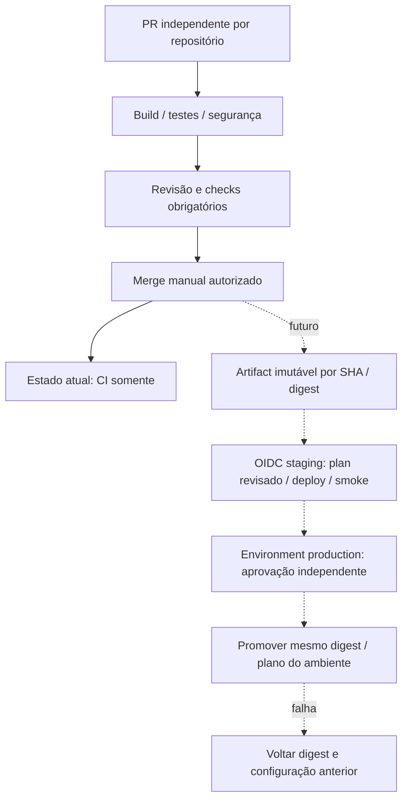

# CI independente e CD futuro

## Implementado nesta PR

Cada repo executa CI próprio em pull_request e push main, com contents:read,
actions fixadas em SHA, timeout e concorrência cancelando CI obsoleto. Sem OIDC,
credenciais AWS, deploy, dispatch entre repos ou acesso à conta. Dependabot atualiza
Actions por PR. Evitar pull_request_target e execução de código não confiável com secrets.

Aplicação: Maven clean verify Java 21 (JUnit, Testcontainers PostgreSQL e Flyway),
JaCoCo mínimo 80% de linhas nos pacotes de domínio, Docker build sem push,
Terraform local fmt/init backend=false/validate, render Kustomize + kubeconform strict.
Os testes de integração terminam em Test e são executados pelo Surefire; Docker é
obrigatório, não há opção silenciosa de ignorá-los. Smoke Kind existente é manual e
somente local ao runner, sem AWS. Artifact JaCoCo permite inspeção da cobertura.

Auth: lint Ruff, testes positivos/negativos JSON Schema, build determinístico do
contrato e checksum; artifact por SHA com retenção 7 dias. Não existe handler ainda.
Infra: fmt/init backend=false/validate, política estática de ausência de recursos,
Checkov sem soft-fail. O scanner não demonstra segurança de recursos ainda inexistentes.
Sem provider AWS nesta fase: nenhum lockfile de provider necessário; adicionar e
revisar `.terraform.lock.hcl` junto com o provider na implementação.

## Desenho futuro — requer nova PR e autorização

Separar CI não privilegiado de publish/deploy. Build uma vez após merge e publicar
imagem em registry com tag sha-<commit>, SBOM/proveniência e digest sha256; promover
exatamente o digest testado em staging para production, sem rebuild nem latest.
Auth futura usa ZIP por SHA/checksum + versão imutável Lambda, alias por ambiente.

OIDC: somente jobs de deploy terão id-token:write. Trust IAM com aud=sts.amazonaws.com
e sub exato `repo:ppdssdev/<repo>:environment:<ambiente>`. Role distinta por repo e
ambiente; sem wildcards de repo/ambiente, sem access keys. Restringir recursos e ações:
infra por stack/tag/região (documentar exceções de APIs sem escopo de recurso), auth
somente função/API autorizadas, app somente promoção e comando SSM específico.
Policy iam:PassRole limitada a roles/serviços exatos; role EC2 separada da role pipeline.

Infra futura: plan protegido no mesmo commit, revisão de custo/diff, artifact privado
com retenção curta por conter valores sensíveis, apply do plano revisado após gate.
Sem plano de PR externo com credenciais. Production exige aprovação do environment,
sem self-review/bypass, branches protegidas, serialização por stack/ambiente e lock
Terraform (não cancelar apply em execução). Alteração de commit invalida plano/aprovação.

App: deploy via SSM documento fixo/allowlist para EC2 (evitar runner permanente no nó),
puxa digest e faz rollout com probes, smoke e prazo. Não expor 6443 para runners.
RDS: verificar backups e janela de manutenção antes de mudanças destrutivas.

Rollback app: redeploy digest/config anterior; migrações expand/contract compatíveis
com pelo menos versão anterior, sem rollback automático destrutivo Flyway. Banco:
PITR/snapshot restaurado em nova instância, validar e trocar endpoint após aprovação;
RPO/RTO devem ser medidos em ensaio. Lambda: voltar alias à versão testada. Terraform:
reverter código, gerar novo plano e revisar; nunca restaurar state antigo cegamente.
Se produção falhar após migração incompatível, interromper promoção e usar runbook.
