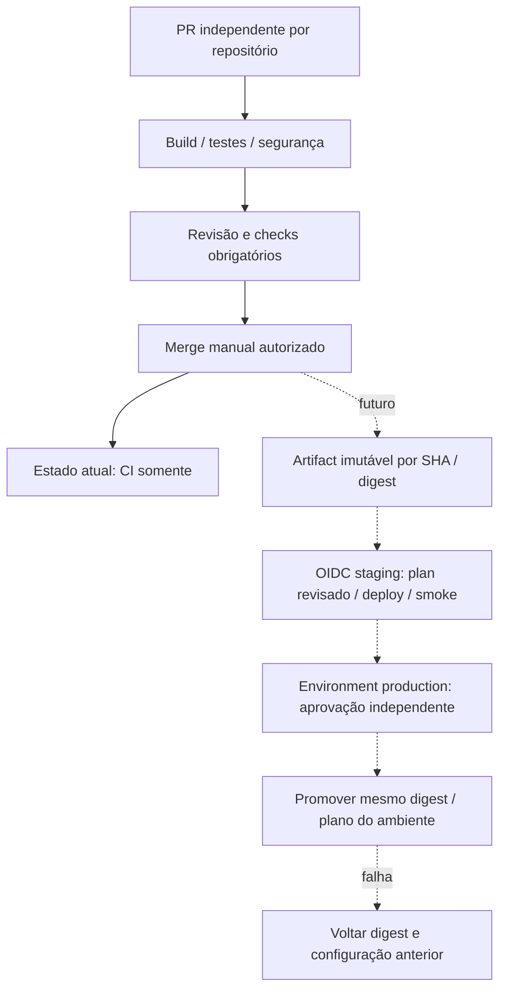

# CI independente e CD futuro

## Implementado nesta PR

Cada repo executa CI próprio em pull_request e push main, com contents:read,
actions fixadas em SHA, timeout e concorrência cancelando CI obsoleto. Sem OIDC,
credenciais AWS, deploy, dispatch entre repos ou acesso à conta. Dependabot atualiza
Actions por PR. Evitar pull_request_target e execução de código não confiável com secrets.

Aplicação: Maven clean verify Java 21 (JUnit, Testcontainers PostgreSQL e Flyway),
JaCoCo mínimo 80% de linhas nos pacotes de domínio, Docker build sem push,
Terraform local fmt/init backend=false/validate, render Kustomize + kubeconform strict.
Os testes de integração terminam em Test e são executados pelo Surefire; Docker é
obrigatório, não há opção silenciosa de ignorá-los. Smoke Kind existente é manual e
somente local ao runner, sem AWS. Artifact JaCoCo permite inspeção da cobertura.

Auth: lint Ruff, testes positivos/negativos JSON Schema, build determinístico do
contrato e checksum; artifact por SHA com retenção 7 dias. Não existe handler ainda.
Infra: fmt/init backend=false/validate, política estática de ausência de recursos,
Checkov sem soft-fail. O scanner não demonstra segurança de recursos ainda inexistentes.
Sem provider AWS nesta fase: nenhum lockfile de provider necessário; adicionar e
revisar `.terraform.lock.hcl` junto com o provider na implementação.

## Desenho futuro — requer nova PR e autorização

Separar CI não privilegiado de publish/deploy. Build uma vez após merge e publicar
imagem em registry com tag sha-<commit>, SBOM/proveniência e digest sha256; promover
exatamente o digest testado em staging para production, sem rebuild nem latest.
Auth futura usa ZIP por SHA/checksum + versão imutável Lambda, alias por ambiente.

OIDC: somente jobs de deploy terão id-token:write. Trust IAM com aud=sts.amazonaws.com
e sub exato `repo:ppdssdev/<repo>:environment:<ambiente>`. Role distinta por repo e
ambiente; sem wildcards de repo/ambiente, sem access keys. Restringir recursos e ações:
infra por stack/tag/região (documentar exceções de APIs sem escopo de recurso), auth
somente função/API autorizadas, app somente promoção e comando SSM específico.
Policy iam:PassRole limitada a roles/serviços exatos; role EC2 separada da role pipeline.

Infra futura: plan protegido no mesmo commit, revisão de custo/diff, artifact privado
com retenção curta por conter valores sensíveis, apply do plano revisado após gate.
Sem plano de PR externo com credenciais. Production exige aprovação do environment,
sem self-review/bypass, branches protegidas, serialização por stack/ambiente e lock
Terraform (não cancelar apply em execução). Alteração de commit invalida plano/aprovação.

App: deploy via SSM documento fixo/allowlist para EC2 (evitar runner permanente no nó),
puxa digest e faz rollout com probes, smoke e prazo. Não expor 6443 para runners.
RDS: verificar backups e janela de manutenção antes de mudanças destrutivas.

Rollback app: redeploy digest/config anterior; migrações expand/contract compatíveis
com pelo menos versão anterior, sem rollback automático destrutivo Flyway. Banco:
PITR/snapshot restaurado em nova instância, validar e trocar endpoint após aprovação;
RPO/RTO devem ser medidos em ensaio. Lambda: voltar alias à versão testada. Terraform:
reverter código, gerar novo plano e revisar; nunca restaurar state antigo cegamente.
Se produção falhar após migração incompatível, interromper promoção e usar runbook.

## Rastreabilidade: SHA testado não é necessariamente HEAD da PR

Os quatro workflows usam `pull_request` e checkout padrão. Nesse evento,
`GITHUB_REF=refs/pull/<n>/merge` e `GITHUB_SHA`/`github.sha` identificam o commit
sintético de merge preparado pelo GitHub para testar HEAD + base. O HEAD da PR é
`github.event.pull_request.head.sha`; a base é `github.event.pull_request.base.sha`.
O SHA sintético pode mudar quando a base muda, mesmo sem alteração no HEAD da PR.
Não é prova de merge na main e não deve ser descrito como commit de release.
Em `push` para main, `GITHUB_SHA` identifica o commit desse push. O metadata
`head_sha` da API de workflow runs não substitui a identificação do checkout testado.
[Semântica oficial](https://docs.github.com/en/actions/reference/workflows-and-actions/events-that-trigger-workflows#pull_request).

| Resultado atual | Identidade correta e limite |
|---|---|
| Auth: `auth-contracts-<GITHUB_SHA>.zip`, checksum e artifact `auth-contracts-<github.sha>` | Em PR, SHA do merge sintético testado; não HEAD da PR. Bundle de contratos, não função Lambda |
| App: `jacoco-report` | Nome não contém SHA; associar ao repositório, run ID, run attempt e job/commit testado |
| App: imagem `tech-challenge-oficina:ci` | Tag temporária local ao runner; sem push/registro/promovibilidade comprovada |
| K3s/RDS | Logs de fmt/validate/Checkov; nenhum artifact de plano ou infraestrutura implantada |

Exemplo real anterior à correção: auth PR #1 HEAD
`1d3a66524c5486c66c168487c04511286263141a`, [run 41235925327](https://github.com/ppdssdev/tech-challenge-oficina-auth-lambda/actions/runs/41235925327),
artifact `auth-contracts-2f469cf783afa3764900717e8b6f8fdfba4b4770` (ID 13055345995).
O segundo SHA identifica o merge de CI, não uma alteração oculta na branch auth.
Os metadados do run registram o primeiro SHA; o nome do bundle registra o segundo.

Para evidência, guardar juntos: repo, evento, PR, HEAD, base, SHA efetivamente
checado (`git rev-parse HEAD`/GITHUB_SHA), run ID/attempt/URL, artifact ID/nome e
checksum do arquivo (ou digest da imagem). No bootstrap esses dados se consultam
no evento/run, Git e artifact; ainda não há manifesto agregado de proveniência.
Não promover artifacts de PR. No futuro publicar artefato de release após merge em
main, registrar essa tupla em manifesto, assinar/atestar proveniência e promover o
mesmo digest de staging para production. Checksum sozinho não atesta origem.

**CI implementado; CD automático não implementado.** Push main repete validações.
Environments protegidos são configuração de governança, não execução de deploy.
O workflow manual Kind cria ambiente descartável local ao runner e não comprova
staging/production AWS. O desenho de CD acima continua pendente de implementação,
aprovação, autorização AWS e evidência de execução.
