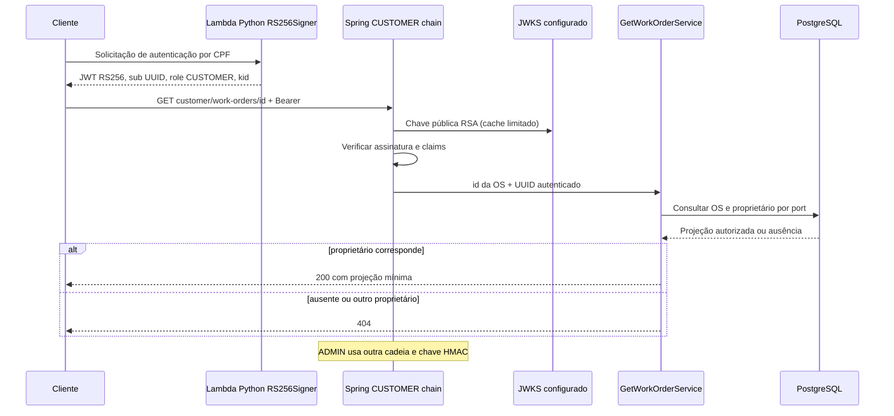

# Integração CUSTOMER RS256 — Prompt 05

Referências inspecionadas: aplicação `61dead2ac89ecea2be2650e310b202a710d43fd9`; emissor Python `bbbf36eecd57a4f35e1792702a13264a7d74ea75` (repositório `ppdssdev/tech-challenge-oficina-auth-lambda`). Nenhuma alteração no emissor foi necessária.

## Domínios de confiança

A primeira SecurityFilterChain seleciona `/api/v1/customer/**` pela rota. OAuth2 Resource Server/Nimbus aceita apenas RS256 com chave RSA do JWKS configurado. Após assinatura, valida issuer, audience, kid não vazio no formato do emissor, UUID canônico, role exatamente CUSTOMER e presença/coerência de iat, nbf e exp. A duração máxima é 900 segundos; datas futuras respeitam skew de até 60 segundos. A autoridade concedida é exclusivamente ROLE_CUSTOMER; o principal é CustomerIdentity(UUID). Não há UserDetailsService nem fallback HMAC nessa cadeia.

A segunda cadeia preserva login e validação HMAC com usuário persistido, e exige ROLE_ADMIN em `/api/v1/admin/**`. O filtro legado tem registro servlet desabilitado para não interceptar requisições da primeira cadeia. Tokens RS256 não passam na validação HMAC. Credencial incompatível com a rota resulta em 401; usuário autenticado sem autoridade exigida recebe 403. As regras públicas e proteções da PR #1 permanecem.

## Autorização de objeto e contrato HTTP

`GET /api/v1/customer/work-orders/{id}` recebe identidade exclusivamente do principal validado. GetWorkOrderService consulta uma projeção via WorkOrderRepositoryPort dentro de TransactionPort. A consulta filtra o id da OS e o UUID do relacionamento persistido Customer pela identidade autenticada, retornando somente `id`, `code`, `status`, `totalAmount`, sem carregar coleções nem adquirir lock exclusivo. Ausência e proprietário diferente geram a mesma exceção/404. Não há customerId de request, nome, documento, placa ou notas administrativas na resposta.



## Configuração por ambiente

| Variável | Regra |
| --- | --- |
| CUSTOMER_JWKS_URI | URI explícita e confiável, exclusivamente da configuração |
| CUSTOMER_JWT_ISSUER | Valor exato do issuer configurado na Lambda |
| CUSTOMER_JWT_AUDIENCE | Audience da Lambda, `oficina-api-<environment>` |
| CUSTOMER_JWT_CLOCK_SKEW_SECONDS | 0–60, padrão 60 |
| CUSTOMER_JWKS_CACHE_SECONDS | 1–300, padrão 300 |

Sem perfil local/test/it, configuração ausente ou URI sem HTTPS impede startup. Perfis production/staging/cloud prevalecem sobre perfis locais. HTTP é permitido apenas para loopback nos perfis locais. Sem as três configurações, local/test/it preservam o desenvolvimento administrativo e rejeitam toda autenticação CUSTOMER. Configuração parcial é inválida. Não há endpoints AWS fictícios.

A origem confiável é o host explicitamente aprovado pelo operador em CUSTOMER_JWKS_URI, protegido junto à configuração da aplicação. Redirects HTTP são desabilitados, TLS é validado pelo cliente Java, conexão e leitura têm timeout de 2 segundos. Headers jku/x5u do token não definem destinos de rede. Somente o JWKS configurado participa da seleção de chave.

## Cache e rotação

O decoder Nimbus usa BoundedJwksSource com um único snapshot obtido exclusivamente da URI configurada. A validade é medida por ticker monotônico desde a obtenção bem-sucedida (TTL configurável de 1–300 segundos), sem renovação por leitura. Chaves conhecidas permitem autenticação durante indisponibilidade somente dentro desse TTL. Expiração descarta o snapshot; erros de rede, JSON inválido e ausência de chave confiável resultam em 401, sem fallback ou stale cache.

Todas as tentativas de obtenção, inclusive falhas, compartilham um intervalo mínimo de `min(5 segundos, TTL)` por decoder/instância. O primeiro acesso pode buscar imediatamente; chamadas concorrentes compartilham a mesma atualização. Um kid ausente durante o intervalo recebe 401. Não há mapa de kids negativos: o estado é constante, independentemente da quantidade de identificadores aleatórios. Falha ao buscar um kid ausente não remove chaves ainda válidas nem estende sua validade. Uma nova chave publicada será reconhecida na primeira requisição após o intervalo, desde que o JWKS esteja disponível. Não há polling em segundo plano.

Investigação: Spring Security 6.5.10 / Nimbus 9.37.4. O [builder do Spring](https://github.com/spring-projects/spring-security/blob/6.5.10/oauth2/oauth2-jose/src/main/java/org/springframework/security/oauth2/jwt/NimbusJwtDecoder.java) usa `rateLimited(false)` e invalida o cache no refresh por chave desconhecida. O teste de caracterização reproduz 11 GETs remotos para aquecimento + 10 kids diferentes na configuração anterior. A implementação protegida faz somente 2 GETs para aquecimento + 40 kids no mesmo intervalo; 24 tentativas concorrentes também compartilham um refresh. A validação criptográfica permanece no Nimbus, com seletor fixo RS256, e os validadores Spring preservam issuer, audience, datas, subject e role.

Publique nova chave com kid distinto junto à anterior antes de emitir tokens novos. Preserve a anterior por pelo menos 900 + 60 segundos após a última emissão com ela; considere também propagação do JWKS e publique a nova chave pelo menos um intervalo de refresh antes de usá-la. Remover uma chave pode levar até o TTL para surtir efeito nos validadores. Revogação emergencial requer invalidar caches/reiniciar validadores e interromper emissão. Timeouts de conexão e leitura continuam em 2 segundos, redirects continuam desabilitados. A atualização serializada pode atrasar requisições concorrentes durante o acesso remoto; os timeouts limitam essa espera por tentativa. O controle local não substitui proteção de tráfego na borda: o limite agregado cresce com o número de réplicas.

Ingress/API Gateway futuro deve limitar taxa/burst por origem e taxa global das rotas CUSTOMER, tamanho de headers e concorrência em voo; limitar também o tráfego agregado ao JWKS. Monitorar 401, latência/falhas de JWKS e refreshes, usando rótulos de cardinalidade limitada (nunca kid, JWT ou CPF). Não confiar em claims ainda não validadas para definir cotas privilegiadas. Dimensionamento desses limites depende do volume real e do número de réplicas; nenhuma infraestrutura AWS é alterada neste fix.

## Leitura e exclusão mútua

`findDetailedById()` carrega a OS sem lock e suas duas coleções em consultas separadas na mesma transação, evitando MultipleBagFetchException. `findDetailedByIdForUpdate()` adquire PESSIMISTIC_WRITE antes de carregar o estado usado por alterações. Diagnóstico, inclusão de itens, notificação de orçamento, finalização e entrega passam pelo método mutável. Aprovação/rejeição preservam `findDetailedByIdForStockUpdate()` e a ordem dos locks de peças; `save()` mantém o lock ao persistir OS e histórico.

A projeção CUSTOMER usa uma consulta sem joins de coleções, contra três consultas do carregamento detalhado. O teste PostgreSQL captura o SQL e comprova que ambas as leituras terminam enquanto outra transação mantém lock exclusivo sobre a mesma OS. Testes de transição concorrente pela porta e pelo caso de uso, histórico com rollback e baixa idempotente de estoque continuam obrigatórios.

## Testes reproduzíveis

Requer Java 21, Maven, Docker acessível e Python com venv:

```bash
python3 -m venv /tmp/customer-issuer-venv
/tmp/customer-issuer-venv/bin/pip install -r src/test/python/requirements.txt
CUSTOMER_TEST_PYTHON=/tmp/customer-issuer-venv/bin/python mvn -B clean verify
```

`src/test/python/auth` contém cópia exata dos módulos necessários do commit Python, com proveniência. `tokens.py` gera RSA descartável em memória e chama RS256Signer.sign para o token positivo. Os negativos derivam do contrato e são assinados em Python. Não há chave privada persistida, token real ou dependência AWS. CustomerJwtIntegrationTest injeta ticker monotônico controlável, avançando o tempo do cache sem alterar o relógio dos claims JWT e sem Thread.sleep. Cada teste expira o snapshot anterior, restaura o servidor e zera o contador; métodos executam sequencialmente, e a concorrência é exercitada explicitamente dentro do teste dedicado. A classe inicia servidor JWKS controlado e usa HTTP real contra Spring em porta aleatória, persistindo Customer/Vehicle/WorkOrder em PostgreSQL 16 via Testcontainers. Testa acesso próprio, 404 de terceiros/ausente, login admin, isolamento bidirecional, adulteração, claims ausentes/incorretas, algoritmos indevidos, cache, rotação, indisponibilidade e endpoints públicos. A CI usa Python 3.13, compatível com o runtime da Lambda, e instala as dependências Python antes de executar Maven; JaCoCo mantém o gate de 80% nos pacotes de domínio.

## Riscos e próxima etapa

CPF sozinho não comprova identidade: o mecanismo do emissor precisa evoluir para verificação adicional. Inativação do cliente não revoga automaticamente token emitido: janela nominal de 15 minutos, acrescida de até 60 segundos de tolerância. Chaves públicas são distribuídas no JWKS; chaves privadas permanecem apenas no emissor. Publicação HTTPS real do JWKS, DNS/TLS, distribuição/cache, armazenamento privado e rotação das chaves, configuração dos ambientes e controles de tráfego dependem da infraestrutura AWS futura. Nenhuma infraestrutura ou deploy foi executado aqui. ADMIN HMAC é dívida temporária até migração para provedor de identidade unificado.

## Evidência da implementação original (PR #5)

Execução local com Python 3.12.3 (a CI fixa Python 3.13) de `mvn -B clean verify` com CUSTOMER_TEST_PYTHON apontando para venv: 145 testes, zero falhas, zero erros, zero ignorados; BUILD SUCCESS. PostgreSQL 16.15 em Testcontainers; migrations V1–V10 aplicadas e testes de migração aprovados. Gate JaCoCo aprovado: pacotes de domínio entre 84,6% e 100% de linhas.

CustomerJwtIntegrationTest: 5 cenários HTTP aprovados, incluindo matriz de tokens negativos. Token positivo produzido por RS256Signer → endpoint próprio 200; mesmo endpoint com identidade de outro cliente 404; UUID inexistente 404; CUSTOMER → ADMIN 401; login ADMIN → endpoint administrativo 200; ADMIN → CUSTOMER 401. Outage de JWKS com cache expirado retorna 401 Bearer diretamente, sem dispatch de erro à cadeia administrativa.

SHA-256 dos arquivos do emissor copiados, iguais aos originais do commit referenciado:

- auth/jwt.py: `c6f2ef211294baff5b81bc03cb9a96e924d3c199a775fbbe11cad0dc8da15a97`
- auth/ports.py: `6ae670220b5b26c67ef9b13887fcea2ff910c89f078ef896819b4b3a90c0aed2`

O resultado remoto de GitHub Actions deve ser consultado nos checks da PR; a execução local não substitui esse resultado.

## Evidência do fix

Os 145 testes anteriores são preservados; stubs e cenários mutáveis usam a nova porta explícita de escrita. A suíte adiciona testes de SQL/concorrência, limite de refresh serial e concorrente, falhas com cooldown, TTL na fronteira exata, remoção de chave sob leituras contínuas e transição concorrente via caso de uso. A rotação HTTP usa ticker injetável e mantém os cenários de sobreposição, recuperação e indisponibilidade antes/depois da expiração. Validação local: `CUSTOMER_TEST_PYTHON=/tmp/prompt04-venv/bin/python mvn -B clean verify` passou com 156 testes, zero falhas, erros ou ignorados; gate JaCoCo aprovado. Os 14 testes JWKS passaram novamente com MethodOrderer.Random, seeds 37 e 97, em execuções separadas. Consulte a nova PR para o SHA e o resultado remoto de Actions.
