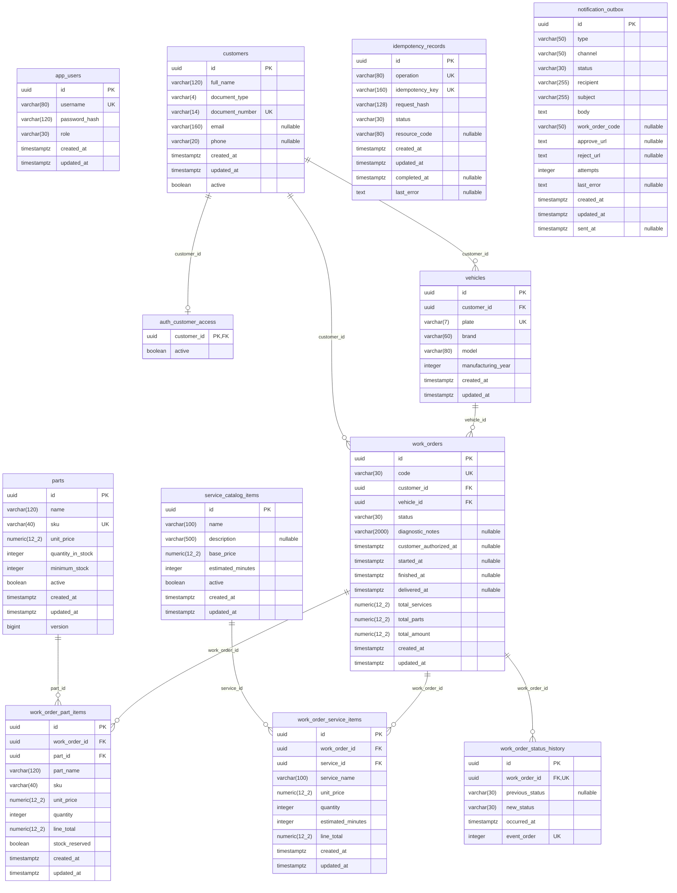

# Modelo físico PostgreSQL — Flyway V1–V11

Gerado em 2026-11-03 pelo catálogo de PostgreSQL **16.15**, após executar em ordem
os onze arquivos SQL reais num container novo, sem rede, dados em tmpfs; removido
no fim. Não houve acesso ao RDS. São **12 tabelas e 2 views, 116 colunas ao todo**
(110 nas tabelas, 6 nas views). Não foi inferido esquema por JPA ou documentação.
`flyway_schema_history` não aparece: é metadado criado pelo Flyway, não tabela das
migrations. A execução direta dos SQL não certifica checksums no RDS nem o runner Flyway.

No Mermaid, `auth_` representa o schema `auth`, `timestamptz` representa
`timestamp with time zone`; `numeric(12_2)` é somente notação gráfica para
`numeric(12,2)`. UK em coluna participante de chave composta **não** significa
unicidade individual. O dicionário e as constraints abaixo são a referência exata.

Não há FK entre outbox e OS nem entre idempotência e OS: `work_order_code` e
`resource_code` são campos de referência textual. Não desenhá-las como relações
referenciais. `app_users` é identidade administrativa independente de `customers`.
O cliente pode ter zero ou uma habilitação explícita em `auth.customer_access`.

## Evolução por migration

| Versão | Alteração efetiva |
|---|---|
| V1 | Oito tabelas iniciais, PK/FK/UNIQUE/CHECK e índices |
| V2 | Seed de serviços/peças; nenhuma coluna/tabela adicional |
| V3 | `parts.version bigint NOT NULL DEFAULT 0` |
| V4 | Inclui BUDGET_REJECTED no CHECK de status da OS |
| V5 | `notification_outbox` |
| V6 | `idempotency_records` |
| V7 | Inclui PROCESSING no CHECK de status da outbox |
| V8 | `customers.active boolean NOT NULL DEFAULT true` |
| V9 | `work_order_status_history`; sem histórico fictício para OS preexistentes |
| V10 | Schema auth e view `customer_identity_v1` |
| V11 | `auth.customer_access`, view V2 e índice de CPF normalizado não único |

## Views (não são tabelas)

| View | Colunas/tipos expostos | Semântica |
|---|---|---|
| `auth.customer_identity_v1` | customer_id uuid; cpf text; active boolean | CPF normalizado e atividade de negócio `customers.active`; preserva ambiguidades |
| `auth.customer_identity_v2` | customer_id uuid; cpf varchar(14); active boolean | CPF canônico de 11 dígitos, exclui colisões normalizadas; `coalesce(customer_access.active,false)`; security_barrier |

O tipo físico de cpf na V2 continua varchar(14), herdado da tabela; o filtro restringe
valores a 11 dígitos. Validadores dos dígitos verificadores estão nas aplicações,
não no CHECK do banco. Grants não são produzidos implicitamente pela view.

## Dicionário completo

### `auth.customer_access`

| Coluna | Tipo PostgreSQL | Nulo | Default |
|---|---|---|---|
| `customer_id` | `uuid` | NO | — |
| `active` | `boolean` | NO | `false` |

### `public.app_users`

| Coluna | Tipo PostgreSQL | Nulo | Default |
|---|---|---|---|
| `id` | `uuid` | NO | — |
| `username` | `varchar(80)` | NO | — |
| `password_hash` | `varchar(120)` | NO | — |
| `role` | `varchar(30)` | NO | — |
| `created_at` | `timestamptz` | NO | — |
| `updated_at` | `timestamptz` | NO | — |

### `public.customers`

| Coluna | Tipo PostgreSQL | Nulo | Default |
|---|---|---|---|
| `id` | `uuid` | NO | — |
| `full_name` | `varchar(120)` | NO | — |
| `document_type` | `varchar(4)` | NO | — |
| `document_number` | `varchar(14)` | NO | — |
| `email` | `varchar(160)` | YES | — |
| `phone` | `varchar(20)` | YES | — |
| `created_at` | `timestamptz` | NO | — |
| `updated_at` | `timestamptz` | NO | — |
| `active` | `boolean` | NO | `true` |

### `public.idempotency_records`

| Coluna | Tipo PostgreSQL | Nulo | Default |
|---|---|---|---|
| `id` | `uuid` | NO | — |
| `operation` | `varchar(80)` | NO | — |
| `idempotency_key` | `varchar(160)` | NO | — |
| `request_hash` | `varchar(128)` | NO | — |
| `status` | `varchar(30)` | NO | — |
| `resource_code` | `varchar(80)` | YES | — |
| `created_at` | `timestamptz` | NO | `now()` |
| `updated_at` | `timestamptz` | NO | `now()` |
| `completed_at` | `timestamptz` | YES | — |
| `last_error` | `text` | YES | — |

### `public.notification_outbox`

| Coluna | Tipo PostgreSQL | Nulo | Default |
|---|---|---|---|
| `id` | `uuid` | NO | — |
| `type` | `varchar(50)` | NO | — |
| `channel` | `varchar(50)` | NO | — |
| `status` | `varchar(30)` | NO | — |
| `recipient` | `varchar(255)` | NO | — |
| `subject` | `varchar(255)` | NO | — |
| `body` | `text` | NO | — |
| `work_order_code` | `varchar(50)` | YES | — |
| `approve_url` | `text` | YES | — |
| `reject_url` | `text` | YES | — |
| `attempts` | `integer` | NO | `0` |
| `last_error` | `text` | YES | — |
| `created_at` | `timestamptz` | NO | `now()` |
| `updated_at` | `timestamptz` | NO | `now()` |
| `sent_at` | `timestamptz` | YES | — |

### `public.parts`

| Coluna | Tipo PostgreSQL | Nulo | Default |
|---|---|---|---|
| `id` | `uuid` | NO | — |
| `name` | `varchar(120)` | NO | — |
| `sku` | `varchar(40)` | NO | — |
| `unit_price` | `numeric(12,2)` | NO | — |
| `quantity_in_stock` | `integer` | NO | — |
| `minimum_stock` | `integer` | NO | — |
| `active` | `boolean` | NO | — |
| `created_at` | `timestamptz` | NO | — |
| `updated_at` | `timestamptz` | NO | — |
| `version` | `bigint` | NO | `0` |

### `public.service_catalog_items`

| Coluna | Tipo PostgreSQL | Nulo | Default |
|---|---|---|---|
| `id` | `uuid` | NO | — |
| `name` | `varchar(100)` | NO | — |
| `description` | `varchar(500)` | YES | — |
| `base_price` | `numeric(12,2)` | NO | — |
| `estimated_minutes` | `integer` | NO | — |
| `active` | `boolean` | NO | — |
| `created_at` | `timestamptz` | NO | — |
| `updated_at` | `timestamptz` | NO | — |

### `public.vehicles`

| Coluna | Tipo PostgreSQL | Nulo | Default |
|---|---|---|---|
| `id` | `uuid` | NO | — |
| `customer_id` | `uuid` | NO | — |
| `plate` | `varchar(7)` | NO | — |
| `brand` | `varchar(60)` | NO | — |
| `model` | `varchar(80)` | NO | — |
| `manufacturing_year` | `integer` | NO | — |
| `created_at` | `timestamptz` | NO | — |
| `updated_at` | `timestamptz` | NO | — |

### `public.work_order_part_items`

| Coluna | Tipo PostgreSQL | Nulo | Default |
|---|---|---|---|
| `id` | `uuid` | NO | — |
| `work_order_id` | `uuid` | NO | — |
| `part_id` | `uuid` | NO | — |
| `part_name` | `varchar(120)` | NO | — |
| `sku` | `varchar(40)` | NO | — |
| `unit_price` | `numeric(12,2)` | NO | — |
| `quantity` | `integer` | NO | — |
| `line_total` | `numeric(12,2)` | NO | — |
| `stock_reserved` | `boolean` | NO | — |
| `created_at` | `timestamptz` | NO | — |
| `updated_at` | `timestamptz` | NO | — |

### `public.work_order_service_items`

| Coluna | Tipo PostgreSQL | Nulo | Default |
|---|---|---|---|
| `id` | `uuid` | NO | — |
| `work_order_id` | `uuid` | NO | — |
| `service_id` | `uuid` | NO | — |
| `service_name` | `varchar(100)` | NO | — |
| `unit_price` | `numeric(12,2)` | NO | — |
| `quantity` | `integer` | NO | — |
| `estimated_minutes` | `integer` | NO | — |
| `line_total` | `numeric(12,2)` | NO | — |
| `created_at` | `timestamptz` | NO | — |
| `updated_at` | `timestamptz` | NO | — |

### `public.work_order_status_history`

| Coluna | Tipo PostgreSQL | Nulo | Default |
|---|---|---|---|
| `id` | `uuid` | NO | — |
| `work_order_id` | `uuid` | NO | — |
| `previous_status` | `varchar(30)` | YES | — |
| `new_status` | `varchar(30)` | NO | — |
| `occurred_at` | `timestamptz` | NO | — |
| `event_order` | `integer` | NO | — |

### `public.work_orders`

| Coluna | Tipo PostgreSQL | Nulo | Default |
|---|---|---|---|
| `id` | `uuid` | NO | — |
| `code` | `varchar(30)` | NO | — |
| `customer_id` | `uuid` | NO | — |
| `vehicle_id` | `uuid` | NO | — |
| `status` | `varchar(30)` | NO | — |
| `diagnostic_notes` | `varchar(2000)` | YES | — |
| `customer_authorized_at` | `timestamptz` | YES | — |
| `started_at` | `timestamptz` | YES | — |
| `finished_at` | `timestamptz` | YES | — |
| `delivered_at` | `timestamptz` | YES | — |
| `total_services` | `numeric(12,2)` | NO | — |
| `total_parts` | `numeric(12,2)` | NO | — |
| `total_amount` | `numeric(12,2)` | NO | — |
| `created_at` | `timestamptz` | NO | — |
| `updated_at` | `timestamptz` | NO | — |

## Constraints efetivas

| Tabela | Nome | Definição PostgreSQL |
|---|---|---|
| `auth.customer_access` | `customer_access_customer_id_fkey` | `FOREIGN KEY (customer_id) REFERENCES customers(id) ON DELETE CASCADE` |
| `auth.customer_access` | `customer_access_pkey` | `PRIMARY KEY (customer_id)` |
| `public.app_users` | `app_users_pkey` | `PRIMARY KEY (id)` |
| `public.app_users` | `app_users_username_key` | `UNIQUE (username)` |
| `public.customers` | `chk_customer_document_type` | `CHECK (((document_type)::text = ANY ((ARRAY['CPF'::character varying, 'CNPJ'::character varying])::text[])))` |
| `public.customers` | `customers_document_number_key` | `UNIQUE (document_number)` |
| `public.customers` | `customers_pkey` | `PRIMARY KEY (id)` |
| `public.idempotency_records` | `chk_idempotency_status` | `CHECK (((status)::text = ANY ((ARRAY['PROCESSING'::character varying, 'COMPLETED'::character varying, 'FAILED'::character varying])::text[])))` |
| `public.idempotency_records` | `idempotency_records_pkey` | `PRIMARY KEY (id)` |
| `public.idempotency_records` | `uk_idempotency_operation_key` | `UNIQUE (operation, idempotency_key)` |
| `public.notification_outbox` | `chk_notification_outbox_channel` | `CHECK (((channel)::text = 'MAILPIT_EMAIL'::text))` |
| `public.notification_outbox` | `chk_notification_outbox_status` | `CHECK (((status)::text = ANY ((ARRAY['PENDING'::character varying, 'PROCESSING'::character varying, 'SENT'::character varying, 'FAILED'::character varying])::text[])))` |
| `public.notification_outbox` | `chk_notification_outbox_type` | `CHECK (((type)::text = 'BUDGET_DECISION'::text))` |
| `public.notification_outbox` | `notification_outbox_pkey` | `PRIMARY KEY (id)` |
| `public.parts` | `parts_pkey` | `PRIMARY KEY (id)` |
| `public.parts` | `parts_sku_key` | `UNIQUE (sku)` |
| `public.service_catalog_items` | `service_catalog_items_pkey` | `PRIMARY KEY (id)` |
| `public.vehicles` | `vehicles_customer_id_fkey` | `FOREIGN KEY (customer_id) REFERENCES customers(id)` |
| `public.vehicles` | `vehicles_pkey` | `PRIMARY KEY (id)` |
| `public.vehicles` | `vehicles_plate_key` | `UNIQUE (plate)` |
| `public.work_order_part_items` | `work_order_part_items_part_id_fkey` | `FOREIGN KEY (part_id) REFERENCES parts(id)` |
| `public.work_order_part_items` | `work_order_part_items_pkey` | `PRIMARY KEY (id)` |
| `public.work_order_part_items` | `work_order_part_items_work_order_id_fkey` | `FOREIGN KEY (work_order_id) REFERENCES work_orders(id) ON DELETE CASCADE` |
| `public.work_order_service_items` | `work_order_service_items_pkey` | `PRIMARY KEY (id)` |
| `public.work_order_service_items` | `work_order_service_items_service_id_fkey` | `FOREIGN KEY (service_id) REFERENCES service_catalog_items(id)` |
| `public.work_order_service_items` | `work_order_service_items_work_order_id_fkey` | `FOREIGN KEY (work_order_id) REFERENCES work_orders(id) ON DELETE CASCADE` |
| `public.work_order_status_history` | `chk_history_creation` | `CHECK (((previous_status IS NOT NULL) OR (((new_status)::text = 'RECEIVED'::text) AND (event_order = 1))))` |
| `public.work_order_status_history` | `chk_history_new_status` | `CHECK (((new_status)::text = ANY ((ARRAY['RECEIVED'::character varying, 'IN_DIAGNOSIS'::character varying, 'WAITING_APPROVAL'::character varying, 'IN_EXECUTION'::character varying, 'FINALIZED'::character varying, 'DELIVERED'::character varying, 'BUDGET_REJECTED'::character varying])::text[])))` |
| `public.work_order_status_history` | `chk_history_previous_status` | `CHECK (((previous_status)::text = ANY ((ARRAY['RECEIVED'::character varying, 'IN_DIAGNOSIS'::character varying, 'WAITING_APPROVAL'::character varying, 'IN_EXECUTION'::character varying, 'FINALIZED'::character varying, 'DELIVERED'::character varying, 'BUDGET_REJECTED'::character varying])::text[])))` |
| `public.work_order_status_history` | `chk_history_transition` | `CHECK (((previous_status)::text IS DISTINCT FROM (new_status)::text))` |
| `public.work_order_status_history` | `uq_work_order_history_sequence` | `UNIQUE (work_order_id, event_order)` |
| `public.work_order_status_history` | `work_order_status_history_event_order_check` | `CHECK ((event_order > 0))` |
| `public.work_order_status_history` | `work_order_status_history_pkey` | `PRIMARY KEY (id)` |
| `public.work_order_status_history` | `work_order_status_history_work_order_id_fkey` | `FOREIGN KEY (work_order_id) REFERENCES work_orders(id)` |
| `public.work_orders` | `chk_work_order_status` | `CHECK (((status)::text = ANY ((ARRAY['RECEIVED'::character varying, 'IN_DIAGNOSIS'::character varying, 'WAITING_APPROVAL'::character varying, 'IN_EXECUTION'::character varying, 'BUDGET_REJECTED'::character varying, 'FINALIZED'::character varying, 'DELIVERED'::character varying])::text[])))` |
| `public.work_orders` | `work_orders_code_key` | `UNIQUE (code)` |
| `public.work_orders` | `work_orders_customer_id_fkey` | `FOREIGN KEY (customer_id) REFERENCES customers(id)` |
| `public.work_orders` | `work_orders_pkey` | `PRIMARY KEY (id)` |
| `public.work_orders` | `work_orders_vehicle_id_fkey` | `FOREIGN KEY (vehicle_id) REFERENCES vehicles(id)` |

## Índices efetivos

| Tabela | Índice | Definição |
|---|---|---|
| `auth.customer_access` | `customer_access_pkey` | `CREATE UNIQUE INDEX customer_access_pkey ON auth.customer_access USING btree (customer_id)` |
| `public.app_users` | `app_users_pkey` | `CREATE UNIQUE INDEX app_users_pkey ON public.app_users USING btree (id)` |
| `public.app_users` | `app_users_username_key` | `CREATE UNIQUE INDEX app_users_username_key ON public.app_users USING btree (username)` |
| `public.customers` | `customers_document_number_key` | `CREATE UNIQUE INDEX customers_document_number_key ON public.customers USING btree (document_number)` |
| `public.customers` | `customers_pkey` | `CREATE UNIQUE INDEX customers_pkey ON public.customers USING btree (id)` |
| `public.customers` | `idx_customers_auth_normalized_cpf` | `CREATE INDEX idx_customers_auth_normalized_cpf ON public.customers USING btree (regexp_replace((document_number)::text, '[^0-9]'::text, ''::text, 'g'::text)) WHERE ((document_type)::text = 'CPF'::text)` |
| `public.customers` | `idx_customers_document_number` | `CREATE INDEX idx_customers_document_number ON public.customers USING btree (document_number)` |
| `public.idempotency_records` | `idempotency_records_pkey` | `CREATE UNIQUE INDEX idempotency_records_pkey ON public.idempotency_records USING btree (id)` |
| `public.idempotency_records` | `idx_idempotency_operation_key` | `CREATE INDEX idx_idempotency_operation_key ON public.idempotency_records USING btree (operation, idempotency_key)` |
| `public.idempotency_records` | `idx_idempotency_status_created_at` | `CREATE INDEX idx_idempotency_status_created_at ON public.idempotency_records USING btree (status, created_at)` |
| `public.idempotency_records` | `uk_idempotency_operation_key` | `CREATE UNIQUE INDEX uk_idempotency_operation_key ON public.idempotency_records USING btree (operation, idempotency_key)` |
| `public.notification_outbox` | `idx_notification_outbox_status` | `CREATE INDEX idx_notification_outbox_status ON public.notification_outbox USING btree (status)` |
| `public.notification_outbox` | `idx_notification_outbox_status_created_at` | `CREATE INDEX idx_notification_outbox_status_created_at ON public.notification_outbox USING btree (status, created_at)` |
| `public.notification_outbox` | `notification_outbox_pkey` | `CREATE UNIQUE INDEX notification_outbox_pkey ON public.notification_outbox USING btree (id)` |
| `public.parts` | `idx_parts_sku` | `CREATE INDEX idx_parts_sku ON public.parts USING btree (sku)` |
| `public.parts` | `parts_pkey` | `CREATE UNIQUE INDEX parts_pkey ON public.parts USING btree (id)` |
| `public.parts` | `parts_sku_key` | `CREATE UNIQUE INDEX parts_sku_key ON public.parts USING btree (sku)` |
| `public.service_catalog_items` | `service_catalog_items_pkey` | `CREATE UNIQUE INDEX service_catalog_items_pkey ON public.service_catalog_items USING btree (id)` |
| `public.vehicles` | `idx_vehicles_customer_id` | `CREATE INDEX idx_vehicles_customer_id ON public.vehicles USING btree (customer_id)` |
| `public.vehicles` | `idx_vehicles_plate` | `CREATE INDEX idx_vehicles_plate ON public.vehicles USING btree (plate)` |
| `public.vehicles` | `vehicles_pkey` | `CREATE UNIQUE INDEX vehicles_pkey ON public.vehicles USING btree (id)` |
| `public.vehicles` | `vehicles_plate_key` | `CREATE UNIQUE INDEX vehicles_plate_key ON public.vehicles USING btree (plate)` |
| `public.work_order_part_items` | `work_order_part_items_pkey` | `CREATE UNIQUE INDEX work_order_part_items_pkey ON public.work_order_part_items USING btree (id)` |
| `public.work_order_service_items` | `work_order_service_items_pkey` | `CREATE UNIQUE INDEX work_order_service_items_pkey ON public.work_order_service_items USING btree (id)` |
| `public.work_order_status_history` | `uq_work_order_history_sequence` | `CREATE UNIQUE INDEX uq_work_order_history_sequence ON public.work_order_status_history USING btree (work_order_id, event_order)` |
| `public.work_order_status_history` | `work_order_status_history_pkey` | `CREATE UNIQUE INDEX work_order_status_history_pkey ON public.work_order_status_history USING btree (id)` |
| `public.work_orders` | `idx_work_orders_code` | `CREATE INDEX idx_work_orders_code ON public.work_orders USING btree (code)` |
| `public.work_orders` | `idx_work_orders_customer_id` | `CREATE INDEX idx_work_orders_customer_id ON public.work_orders USING btree (customer_id)` |
| `public.work_orders` | `idx_work_orders_status` | `CREATE INDEX idx_work_orders_status ON public.work_orders USING btree (status)` |
| `public.work_orders` | `idx_work_orders_vehicle_id` | `CREATE INDEX idx_work_orders_vehicle_id ON public.work_orders USING btree (vehicle_id)` |
| `public.work_orders` | `work_orders_code_key` | `CREATE UNIQUE INDEX work_orders_code_key ON public.work_orders USING btree (code)` |
| `public.work_orders` | `work_orders_pkey` | `CREATE UNIQUE INDEX work_orders_pkey ON public.work_orders USING btree (id)` |

## Proveniência e reprodução

[Migrations fonte](../../src/main/resources/db/migration). SHA-256 por arquivo:

| Arquivo | SHA-256 |
|---|---|
| [V1__create_schema.sql](../../src/main/resources/db/migration/V1__create_schema.sql) | `2cc1f2e40ae2358e145edee5f5b16b473ea916cc4cce7e080b83dd1e10b2aa31` |
| [V2__seed_catalog.sql](../../src/main/resources/db/migration/V2__seed_catalog.sql) | `e7a70c8b8d44976db46b50a5bc5bb80a28d15cc584603f7d5f8506249336c389` |
| [V3__add_part_version.sql](../../src/main/resources/db/migration/V3__add_part_version.sql) | `77b44a5d7dcd1c28d51dae96c14f6a94d615080a69d87a573999aa6b5f5718e8` |
| [V4__add_budget_rejected_work_order_status.sql](../../src/main/resources/db/migration/V4__add_budget_rejected_work_order_status.sql) | `1855395cd8a8c4221a18e8e5302cde69d4843aae9ac27a033c0291660af885d7` |
| [V5__create_notification_outbox.sql](../../src/main/resources/db/migration/V5__create_notification_outbox.sql) | `6c6b525c17fb4018a50e43780e6ef3d08c0e20ead3ce94cca0342b00bd8d0eff` |
| [V6__create_idempotency_records.sql](../../src/main/resources/db/migration/V6__create_idempotency_records.sql) | `5a223e32078ed2c0aad2fc065ca2432ba5524fecf40a4bae516e343b0b45567a` |
| [V7__add_processing_status_to_notification_outbox.sql](../../src/main/resources/db/migration/V7__add_processing_status_to_notification_outbox.sql) | `11b725a0996d1f285240094528fea849d0e53ec0e7a26238b7c9b105f99ecb86` |
| [V8__add_customer_active.sql](../../src/main/resources/db/migration/V8__add_customer_active.sql) | `a835ae1cca1ecabdd8573ffd2b0637076b82f96bce9cd92d5fad7f2ea926d2a1` |
| [V9__create_work_order_status_history.sql](../../src/main/resources/db/migration/V9__create_work_order_status_history.sql) | `9a3045ca8eae01295bd6a9ea6a8493d4e273b5bc9ab327c65b338e13d013a289` |
| [V10__customer_identity_view.sql](../../src/main/resources/db/migration/V10__customer_identity_view.sql) | `13330d9e760f9b12c18d095e2df2e8d471ff27c7819c8d7042194fca6abd994a` |
| [V11__create_explicit_customer_identity_view.sql](../../src/main/resources/db/migration/V11__create_explicit_customer_identity_view.sql) | `ac0d5c9fcfbf5d09ab321cc00aa6d4bf08b65b5f2c9ff58af693211b11b53524` |

Reprodução: executar os SQL V1–V11 numericamente com `psql -X -v ON_ERROR_STOP=1`
num PostgreSQL 16 vazio e descartável; nunca contra staging para gerar um desenho.
Extrair `information_schema.columns`, `pg_constraint`/`pg_get_constraintdef` e
`pg_indexes` dos schemas public/auth. Conferir 12 tabelas, 2 views e 116 colunas;
comparar SHA-256 das entradas. A consulta de views pode reportar nullable para
expressões mesmo com filtro/coalesce; o diagrama não inventa NOT NULL em views.
