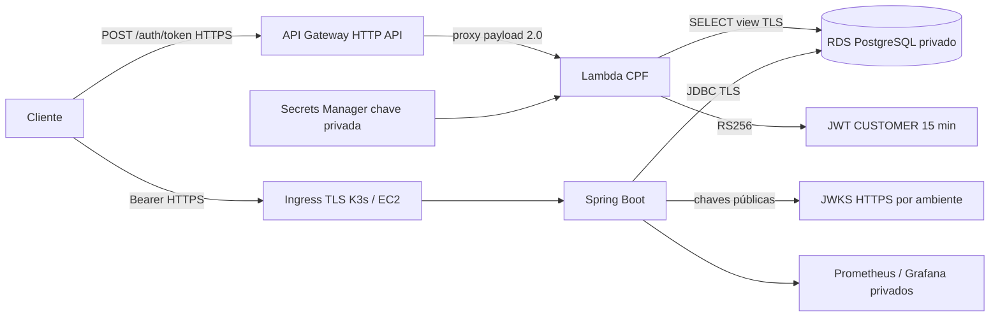

# Arquitetura proposta — não implantada

## RDS e identidade

API recebe `SPRING_DATASOURCE_URL=jdbc:postgresql://<endpoint>:5432/oficina_db?sslmode=verify-full&sslrootcert=/etc/rds-ca/global-bundle.pem`,
`SPRING_DATASOURCE_USERNAME` e `SPRING_DATASOURCE_PASSWORD` por Secret Kubernetes
injetado no deploy futuro. CA RDS confiável montada como arquivo. Nunca commitar
Secret preenchido, senha em tfvars/state/outputs ou imprimir conteúdo nos logs.
Usar usuários separados para migrations, API e consulta auth. Migrador recebe DDL;
API recebe DML necessário; Lambda só SELECT na view `auth.customer_identity_v1`.
Migração futura deve separar credencial Flyway da credencial runtime (hoje compartilham datasource).

A aplicação é dona da view e grants via Flyway: customer_id (UUID), cpf normalizado
(11 caracteres), active (boolean). Adaptar colunas reais na migração, com índice único
adequado e tratamento de clientes CNPJ fora do login CPF. Lambda usa consulta
parametrizada, retorno único, timeout e conexões limitadas por reserved concurrency;
não copia regras ou entidades Java. Banco indisponível retorna 503, sem emitir JWT.

API Gateway HTTP API pertence ao repo auth: rota POST /auth/token, integração proxy
payload 2.0, permissão invoke restrita a API/stage/rota; body <=1 KiB, throttling,
logs sem CPF/token. Resposta 401 igual para CPF ausente/inativo; validar dígitos
verificadores antes da consulta. CPF sozinho não comprova posse: risco aceito apenas
para o exercício, exigindo fator adicional antes de produção real.

## Assinatura e validação JWT

Contrato futuro RS256 apenas; JWT header kid; claims iss por ambiente,
aud=oficina-api-<environment>, sub=UUID, role=CUSTOMER, iat/nbf/exp, TTL=900 s,
tolerância de relógio <=60 s. Não incluir CPF; nunca conceder ADMIN a login CPF.
Spring Security Resource Server deve verificar assinatura, algoritmo, issuer,
audience, validade e converter role explicitamente. Rejeitar alg none/HMAC e kid
inesperado. Configurar URI JWKS HTTPS por ambiente; cache limitado e falha fechada
quando nenhuma chave válida estiver disponível.

**Estado atual:** API usa `APP_JWT_SECRET` e validador HMAC; esta PR não altera o runtime.
Uma PR posterior deverá migrar emissão/validação, inclusive login administrativo,
antes de integrar a Lambda. Não ativar aceitação simultânea indiscriminada HS/RS.
Token emitido antes da inativação pode durar até 15 min; revogação imediata exigiria
consulta/introspecção ou denylist e será decisão explícita.

Chave RSA privada futura por ambiente em Secrets Manager, leitura somente pela
role auth e cache em memória; distribuição pública JWKS via S3 HTTPS, sem chave
privada. Rotação: publicar chave pública nova, aguardar propagação/cache, trocar kid
do emissor, manter chave anterior por TTL + tolerância + cache máximo, depois retirar.
Sem KMS assimétrico inicialmente para reduzir dependências e chamadas de assinatura;
criptografia em repouso dos segredos continua obrigatória. Lambda precisará endpoint
VPC Secrets Manager ou alternativa aprovada; subnet privada não ganha internet pelo
API Gateway. Esse custo está incluído no planejamento, sem NAT Gateway.

## Isolamento, operação e riscos

staging/production: VPCs, subnets, instâncias, bancos, SGs, secrets, chaves, issuer,
roles OIDC, namespaces, registries/tags e prefixes state separados. Duas contas seria
o ideal; no Free Plan adotar isolamento dentro da conta, sujeito à elegibilidade.
Não compartilhar banco nem chave JWT. Para poupar créditos, provisionar inicialmente
somente staging após aprovação; production continua projeto até orçamento específico.

K3s single-node em EC2 t3.small proposto, EBS criptografado, IMDSv2 obrigatório,
sem SSH público e sem Kubernetes API 6443 pública. Administração futura via SSM;
runner GitHub não recebe kubeconfig administrativo. Ingress HTTPS público somente 443,
SSM por saída HTTPS da subnet pública; restringir egress e IAM. Fixar versão/checksum
K3s e AMI na implementação, sem curl|sh sem verificação. RDS privado em subnets de
duas AZs, instância inicialmente Single-AZ. Não usar EKS, NAT Gateway ou ALB inicial.
Single-node/Single-AZ não oferece HA e pode sofrer pressão de memória com observabilidade.

Prometheus/Grafana internos, coleta Actuator autenticada, retenção curta e volumes
limitados. Logs estruturados com correlation-id e sem CPF/JWT/senha; alarmes futuros
para erros, latência, saturação, falha de backup e gasto. Endpoint metrics não público.
