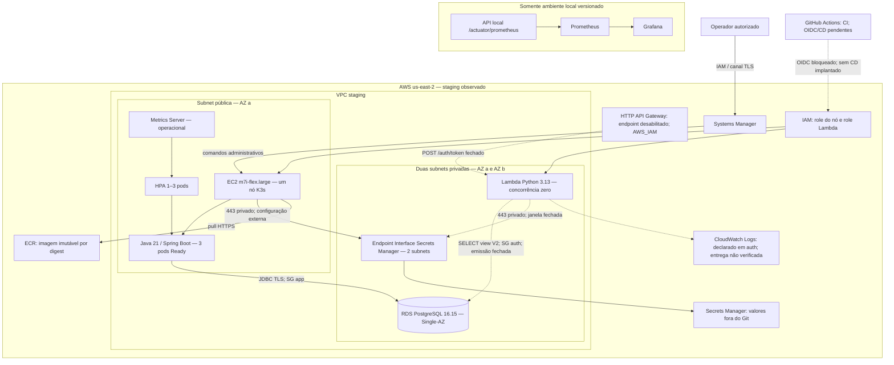
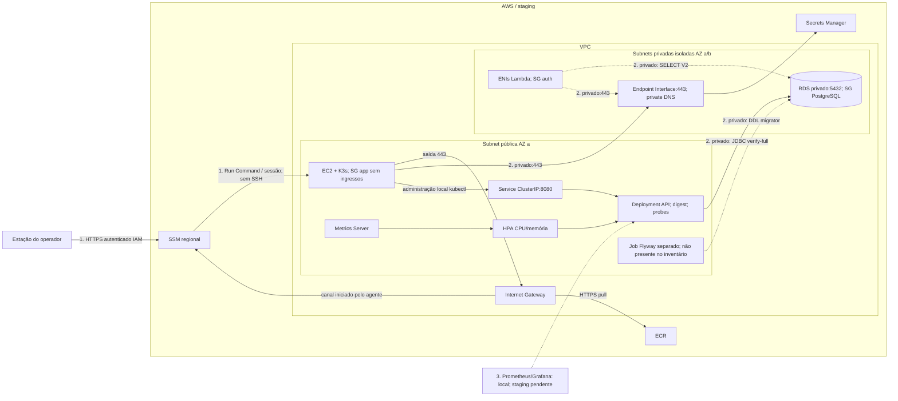

# Arquitetura implantada e limites de comprovação

Baseline e classificação: [índice](README.md). Observações AWS/K3s em
2026-11-03: [registro sanitizado](operational-evidence.md). Linha contínua representa
recurso/relação observada ou declarada no código; **não afirma que toda chamada foi
executada**. Linha pontilhada identifica fluxo fechado, local ou planejado.

## Componentes

Lambda é um serviço regional com interfaces de rede nas subnets privadas; o desenho
não implica servidores Lambda dedicados em cada AZ. RDS tem subnet group em duas
AZs, mas **uma instância Single-AZ**, sem réplica standby. Secrets Manager, ECR,
SSM e API Gateway são serviços AWS fora das subnets da aplicação. Tracing não foi
incluído como componente implantado: não há coletor/exportador comprovado.

## Implantação e caminhos de rede

1. **Administração:** SSM usa conexão de saída do agente; a seta de comando não é
   ingresso TCP público na EC2. Consultas kubectl foram executadas por Run Command.
   Túnel Session Manager/port-forward é procedimento operacional, não endpoint público.
2. **Aplicação:** API/RDS e Lambda/RDS usam caminho privado, porta 5432 e SGs por
   origem. TLS `verify-full` é exigido na configuração; a auditoria não abriu sessão
   SQL remota para comprovar TLS efetivo. Lambda lê segredo por endpoint Interface;
   não há NAT Gateway na topologia versionada. Não há Ingress/ALB no inventário.
3. **Observabilidade:** Metrics Server alimenta HPA; não armazena séries históricas
   como Prometheus. Prometheus/Grafana locais não comprovam observabilidade cloud.
   `/actuator/prometheus` é `permitAll()` no código: ClusterIP/SG fechado limita
   exposição externa, mas não demonstra isolamento entre workloads no cluster.

## Fontes e divergências

- [network.tf](https://github.com/ppdssdev/tech-challenge-oficina-infra-k3s/blob/10fa81e88e8e5cd9ab06fe8661cf1a735be26675/network.tf), [compute.tf](https://github.com/ppdssdev/tech-challenge-oficina-infra-k3s/blob/10fa81e88e8e5cd9ab06fe8661cf1a735be26675/compute.tf), [security.tf](https://github.com/ppdssdev/tech-challenge-oficina-infra-k3s/blob/10fa81e88e8e5cd9ab06fe8661cf1a735be26675/security.tf):
  uma subnet pública, duas privadas, sem NAT; EC2 padrão `t3.medium`, observado
  `m7i-flex.large` (tipo permitido pela variável, não prova de drift).
- [secretsmanager-endpoint.tf](https://github.com/ppdssdev/tech-challenge-oficina-infra-k3s/blob/10fa81e88e8e5cd9ab06fe8661cf1a735be26675/secretsmanager-endpoint.tf): endpoint opcional, padrão desligado;
  observado habilitado. Valores efetivos de tfvars/state não foram consultados.
- [rds.tf](https://github.com/ppdssdev/tech-challenge-oficina-infra-rds/blob/51bb0557156a42e0f6f71c05bc304a6e9af362bf/rds.tf), [network.tf](https://github.com/ppdssdev/tech-challenge-oficina-infra-rds/blob/51bb0557156a42e0f6f71c05bc304a6e9af362bf/network.tf): privado, criptografado,
  Single-AZ, duas origens SG; configuração observada compatível.
- [infra/terraform/main.tf](https://github.com/ppdssdev/tech-challenge-oficina-auth-lambda/blob/1ff247717e35054967495ba7684742c67aaeb9da/infra/terraform/main.tf): HTTP API endpoint desabilitado,
  rota AWS_IAM, concorrência padrão zero, janela sintética opcional de 2.
- [Manifest API](../../k8s/staging/api.yaml), [HPA](../../k8s/staging/hpa.yaml),
  [Job](../../k8s/staging/migration-job.yaml), [Compose](../../docker-compose.yml).

Sem state ou plan, esta comparação não certifica ausência de drift. Não há evidência
de sincronizador automático Secrets Manager → Kubernetes; o provisionamento externo
de Secrets/ConfigMaps é descrito no [runbook existente](../staging/deployment.md).
