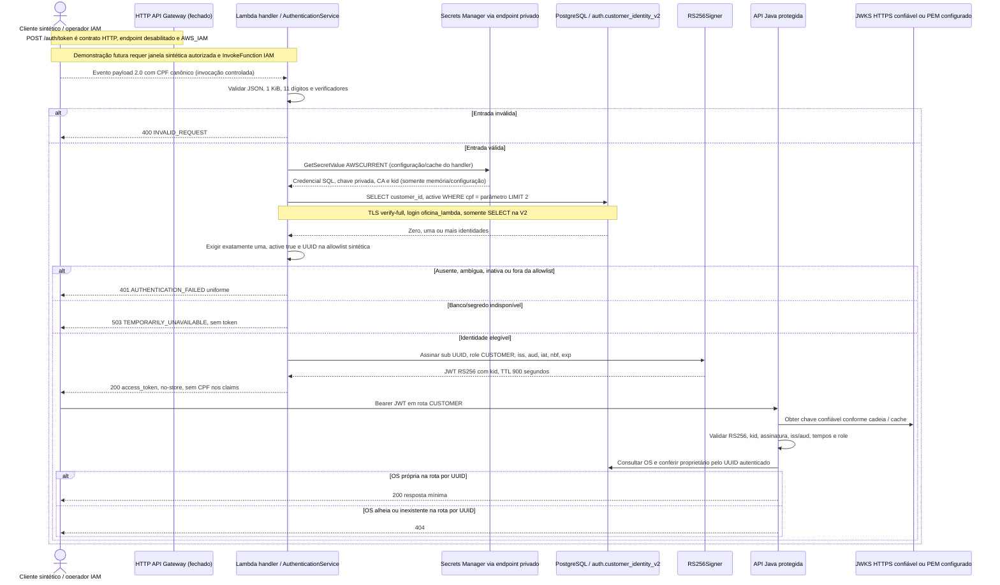
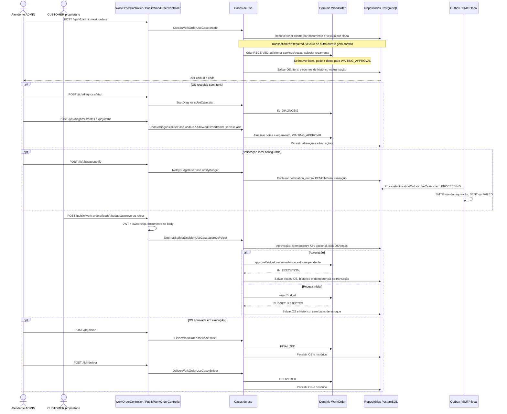

# Sequências verificadas no código

Os diagramas descrevem implementação e casos de uso, não um teste cloud realizado
nesta revisão. [Estado operacional](operational-evidence.md): Lambda fechada com
concorrência zero; nenhuma chamada de autenticação foi disparada nesta auditoria.

## CPF → Lambda → PostgreSQL → JWT → API

A view V2 publica `customer_id`, `cpf`, `active`; o adapter lê somente UUID e active.
`active` vem de `auth.customer_access`, default false; `customers.active` tem outra
semântica. CPF normalizado ambíguo suprime a identidade. A assinatura não consulta
serviço KMS: usa chave RSA do segredo composto. O handler reutiliza serviço em cache;
não se pressupõe leitura de segredo em cada request.

`/api/v1/customer/**` usa JWKS e principal `CustomerIdentity`. As rotas por código
`/api/v1/public/work-orders/**` **também exigem autenticação**, usam configuração PEM
e autorização de método por ownership (403 para alheia/inexistente nesse controle).
O nome `public` não significa acesso anônimo. ADMIN usa login próprio e HMAC,
sem promoção de CUSTOMER para ADMIN ou fallback entre algoritmos.

Fontes: [auth/handler.py](https://github.com/ppdssdev/tech-challenge-oficina-auth-lambda/blob/1ff247717e35054967495ba7684742c67aaeb9da/auth/handler.py), [auth/request.py](https://github.com/ppdssdev/tech-challenge-oficina-auth-lambda/blob/1ff247717e35054967495ba7684742c67aaeb9da/auth/request.py),
[auth/postgres.py](https://github.com/ppdssdev/tech-challenge-oficina-auth-lambda/blob/1ff247717e35054967495ba7684742c67aaeb9da/auth/postgres.py), [auth/cloud.py](https://github.com/ppdssdev/tech-challenge-oficina-auth-lambda/blob/1ff247717e35054967495ba7684742c67aaeb9da/auth/cloud.py),
[auth/jwt.py](https://github.com/ppdssdev/tech-challenge-oficina-auth-lambda/blob/1ff247717e35054967495ba7684742c67aaeb9da/auth/jwt.py), [cadeia JWKS](../../src/main/java/br/com/fiap/techchallenge/oficina/configuration/CustomerSecurityConfig.java),
[segurança das demais rotas](../../src/main/java/br/com/fiap/techchallenge/oficina/configuration/SecurityConfig.java),
[controller por código](../../src/main/java/br/com/fiap/techchallenge/oficina/adapters/in/web/PublicWorkOrderController.java).

## Abertura e processamento de OS

As rotas abreviadas `/{id}` pertencem a `/api/v1/admin/work-orders`; a decisão por
código pertence a `/api/v1/public/work-orders`. ADMIN também pode aprovar via
`DecideBudgetUseCase.approve` em `POST /api/v1/admin/work-orders/{id}/approve`.
Recusa após início da execução viola regra de domínio; não é cancelamento genérico.
Inclusão de novos itens durante execução pode exigir nova aprovação. Um replay
idempotente aprovado retorna o estado corrente sem repetir baixa; hash divergente
ou registro PROCESSING/FAILED provoca conflito. A checagem de ownership ocorre
antes do caso de uso. Outbox e idempotência não são serviços externos nem brokers.

Fontes: [casos de uso reais](../../src/main/java/br/com/fiap/techchallenge/oficina/application/usecase),
[WorkOrder](../../src/main/java/br/com/fiap/techchallenge/oficina/domain/model/workorder/WorkOrder.java),
[controllers](../../src/main/java/br/com/fiap/techchallenge/oficina/adapters/in/web),
[migrations](../../src/main/resources/db/migration). SMTP/outbox automática de staging
estão desabilitados na [configuração staging](../../src/main/resources/application-staging.yml).
